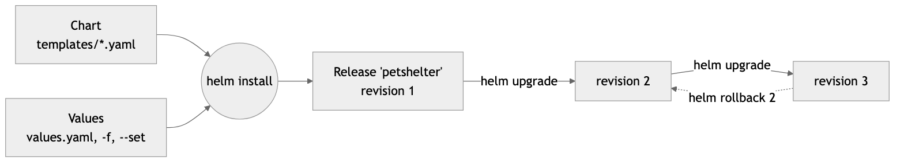
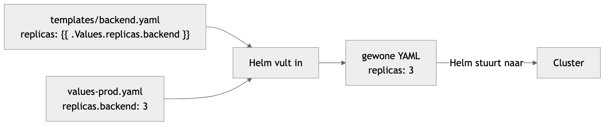
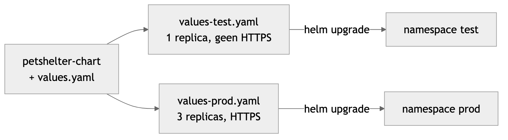

<!--  -->

<!-- _class: lead -->

# Les 7 — Helm

Je Kubernetes-app als één pakket

Volledige uitgewerkte notities: [helm.md](helm.md) · [PetShelter naar Helm](helm-petshelter.md)

---

## Agenda

1. Waarom Helm?
2. Vier begrippen
3. Een bestaande chart gebruiken
4. Je eigen chart
5. Templates
6. Eén chart, meerdere omgevingen
7. PetShelter als chart
8. Fouten zoeken

---

<!-- _class: lead -->

## 1. Waarom Helm?

---

## Het probleem met losse YAML

<style scoped>section { font-size: 28px; }</style>

PetShelter in les 6: **5 bestanden** en `kubectl apply -f` in de juiste volgorde

- Test én productie? → alles **kopiëren** en met de hand aanpassen
- Na een paar weken zijn de kopieën niet meer gelijk
- Update mislukt? → geen knop "terug naar vorige versie"
- Verwijderen? → zelf alles terugvinden

---

## Helm = package manager voor Kubernetes

<style scoped>section { font-size: 28px; }</style>

Zoals `npm` voor Node.js of `apt` voor Ubuntu

- Al je YAML in één **chart**, met **variabelen** in plaats van vaste waarden
- Installeren, upgraden, verwijderen met **één commando**
- Elke versie onthouden → `helm rollback`
- Per omgeving enkel een klein bestand met de **verschillen**

---

<!-- _class: lead -->

## 2. Vier begrippen

---

## Chart, values, release, repository

<style scoped>table { font-size: 25px; }</style>

| Begrip | Wat | Vergelijking |
|---|---|---|
| **Chart** | map met YAML-templates + standaardwaarden | npm-package |
| **Values** | de instellingen: replicas, image, hostnaam | opties van een installer |
| **Release** | een geïnstalleerde chart, met een naam | geïnstalleerd programma |
| **Repository** | plaats waar charts gedeeld worden | npm registry |

Zoeken: [artifacthub.io](https://artifacthub.io)

---

## Releases en revisions



Elke `install`, `upgrade` of `rollback` = een nieuwe **revision**

Dezelfde chart kan je meerdere keren installeren, met een andere naam of namespace

---

<!-- _class: lead -->

## 3. Een bestaande chart gebruiken

---

## Installeren

```bash
brew install helm              # Windows: winget install Helm.Helm
helm version                   # gebruikt dezelfde cluster als kubectl
```

```bash
helm repo add podinfo https://stefanprodan.github.io/podinfo
helm repo update
helm show values podinfo/podinfo | less        # wat kan ik instellen?

helm install mijn-podinfo podinfo/podinfo \
  --set replicaCount=2 --set ui.message="Hallo VIVES"
```

---

## Bekijken, upgraden, terugdraaien

<style scoped>pre { font-size: 0.8em; }</style>

```bash
helm list
helm status mijn-podinfo
kubectl port-forward svc/mijn-podinfo 9898:9898   # http://localhost:9898

helm upgrade mijn-podinfo podinfo/podinfo --reuse-values --set replicaCount=3
helm history mijn-podinfo          # revision 1 en 2
helm rollback mijn-podinfo 1       # terug naar 2 replicas
helm get values mijn-podinfo

helm uninstall mijn-podinfo        # alles weg
```

`--reuse-values` vergeten? Dan begint Helm opnieuw van de **standaardwaarden**

---

<!-- _class: lead -->

## 4. Je eigen chart

---

## Een chart is gewoon een map

```
hello-chart/
├── Chart.yaml          naam en versie
├── values.yaml         standaardwaarden
└── templates/          YAML met {{ }}
    ├── deployment.yaml
    └── service.yaml
```

```yaml
# Chart.yaml
apiVersion: v2          # Helm 3 of nieuwer
name: hello
version: 0.1.0          # versie van de chart
appVersion: "1.10"      # versie van de app
```

---

## values.yaml + template

<style scoped>pre { font-size: 0.75em; }</style>

```yaml
# values.yaml
replicas: 1
image: traefik/whoami:v1.10
env:
  WHOAMI_NAME: hallo
```

```yaml
# templates/deployment.yaml
metadata:
  name: {{ .Release.Name }}
spec:
  replicas: {{ .Values.replicas }}
  ...
      containers:
        - name: web
          image: {{ .Values.image }}
```


---

## Helm vult de templates in



Je schrijft templates + values · Helm maakt er gewone YAML van en stuurt die naar de cluster

---

## Eerst kijken, dan installeren

```bash
helm lint ./hello-chart               # fouten?
helm template demo ./hello-chart      # de ingevulde YAML, niets geïnstalleerd

helm install hallo ./hello-chart
helm install dag   ./hello-chart --set replicas=2 --set env.WHOAMI_NAME=dag
kubectl get deploy                    # hallo 1/1, dag 2/2
```

Namen uit `{{ .Release.Name }}` → twee releases botsen niet

`helm create` maakt veel voorbeeldbestanden: goed als naslag, te veel om mee te beginnen

---

<!-- _class: lead -->

## 5. Templates

---

## Wat je het meest gebruikt

<style scoped>table { font-size: 24px; }</style>

| Template | Resultaat |
|---|---|
| `{{ .Values.replicas }}` | waarde uit values.yaml |
| `{{ .Values.image.tag }}` | geneste waarde |
| `{{ .Release.Name }}` / `{{ .Release.Namespace }}` | naam / namespace van de release |
| `{{ .Values.host \| quote }}` | `"mijnsite.be"` |
| `{{ .Values.port \| default 3000 }}` | `3000` als `port` leeg is |
| `{{- toYaml .Values.resources \| nindent 12 }}` | een heel blok, ingesprongen |

`{{-` haalt de witruimte vóór de tag weg → geen lege regels

---

## Voorwaarden en lussen

<style scoped>pre { font-size: 0.8em; }</style>

```yaml
{{- if .Values.ingress.enabled }}
apiVersion: networking.k8s.io/v1
kind: Ingress
...
{{- end }}
```

```yaml
env:
  {{- range $name, $value := .Values.env }}
  - name: {{ $name }}
    value: {{ $value | quote }}
  {{- end }}
```

---

## Typische fouten

<style scoped>section { font-size: 27px; }</style>

- `nil pointer evaluating interface {}.tag`
  → `.Values.image.tag` gebruikt, maar `image:` bestaat niet
- Getal waar een string moet (`value: 3000` in `env`) → `| quote`
- Rare inspringing na `if` of `range` → bekijk `helm template`

---

<!-- _class: lead -->

## 6. Eén chart, meerdere omgevingen

---

## Eén chart, twee omgevingen



`values.yaml` = standaard · per omgeving een klein bestand met **enkel de verschillen**

---

## Enkel de verschillen

```yaml
# values-test.yaml
ingress:
  enabled: true
  host: petshelter-test.localhost
```

```yaml
# values-prod.yaml
replicas:
  frontend: 3
  backend: 3
ingress:
  host: petshelter.jouwdomein.be
```


---

## Deployen per omgeving

<style scoped>pre { font-size: 0.75em; }</style>

```bash
helm upgrade --install petshelter ./petshelter-chart \
  -n test --create-namespace -f petshelter-chart/values-test.yaml

helm upgrade --install petshelter ./petshelter-chart \
  -n prod --create-namespace -f petshelter-chart/values-prod.yaml

helm list -A
```

- `upgrade --install`: installeert de eerste keer, upgradet daarna → ideaal voor CI/CD
- **Wie wint?** `values.yaml` → `-f` (laatste bestand wint) → `--set`
- Geef bij elke upgrade je `-f` opnieuw mee

---

<!-- _class: lead -->

## 7. PetShelter als chart

---

## Van les 6 naar een chart

<style scoped>table { font-size: 22px; }</style>

| Les 6 | Chart | Waarom |
|---|---|---|
| 5 bestanden | 1 bestand per onderdeel | overzichtelijker |
| `mongodb-service`, `backend-service`, … | `database`, `backend`, `frontend` | zoals in de Final-template |
| ConfigMap `mongodb-config` | `MONGO_HOST: database` | één waarde |
| wachtwoord in `mongodb-secret.yaml` | Secret **buiten** de chart | geen wachtwoorden in git |
| frontend `NodePort` 32500 | `ClusterIP` + Ingress | geen open poorten |
| geen opslag | PersistentVolumeClaim | data overleeft een herstart |

Vaste namen → elke omgeving in een **eigen namespace**

---

## De Secret maak je zelf

<style scoped>section { font-size: 27px; } pre { font-size: 0.8em; }</style>

```bash
kubectl create namespace test
kubectl create secret generic db-credentials -n test \
  --from-literal=DB_USER=admin \
  --from-literal=DB_PASSWORD='kies-een-wachtwoord'
```

De chart **verwijst** er enkel naar:

```yaml
valueFrom:
  secretKeyRef:
    name: {{ .Values.dbSecret }}
    key: DB_PASSWORD
```

In de Final: de pipeline maakt de Secret vanuit GitHub Secrets

---

## Updaten en terugdraaien

<style scoped>pre { font-size: 0.8em; }</style>

```bash
helm upgrade petshelter ./petshelter-chart -n test \
  -f petshelter-chart/values-test.yaml \
  --set images.backend=dimilan/pet-shelter-backend:v2

kubectl get pods -n test        # ImagePullBackOff? tag bestaat niet
helm history petshelter -n test
helm rollback petshelter 1 -n test
```

De oude pod blijft draaien tot de nieuwe Ready is → je app blijft werken

Zo werkt ook je CI/CD: nieuwe image → `helm upgrade --install --set images.backend=<tag>`

---

<!-- _class: lead -->

## 8. Fouten zoeken

---

## Probleem → oplossing

<style scoped>table { font-size: 21px; }</style>

| Probleem | Oplossing |
|---|---|
| `cannot re-use a name that is still in use` | `helm upgrade --install` |
| `CreateContainerConfigError` | Secret ontbreekt in die namespace of de keys kloppen niet |
| `ImagePullBackOff` | verkeerde tag, of geen image voor amd64/arm64 |
| backend `CrashLoopBackOff` | `kubectl logs deploy/backend -n test` |
| database `Pending` | `kubectl get pvc -n test` |
| ander wachtwoord, MongoDB weigert | wachtwoord geldt enkel bij de **eerste** start: PVC verwijderen |
| wijziging niet zichtbaar | `helm get values` → `-f` vergeten? |

```bash
helm get manifest petshelter -n test    # wat is er echt geïnstalleerd?
```

---

## Commando's

<style scoped>table { font-size: 22px; }</style>

| Commando | Wat |
|---|---|
| `helm repo add` / `helm repo update` | repository toevoegen / bijwerken |
| `helm show values <chart>` | alle instellingen van een chart |
| `helm lint` / `helm template` | controleren / YAML tonen |
| `helm upgrade --install <release> <chart>` | installeren of upgraden |
| `helm list -A` / `helm status` | releases / status |
| `helm history` / `helm rollback <release> <rev>` | geschiedenis / terug |
| `helm uninstall <release>` | verwijderen |

---

## Volgende stappen

- [PetShelter naar Helm](helm-petshelter.md): de chart stap voor stap, test en prod
- [Helm Advanced](helm-advanced.md): helpers, tests, dependencies, publiceren, CI/CD
- **Ingress** (Les 8): één ingang met HTTPS, in je chart
- **Final**: `helm/app/` met `values-test.yaml` en `values-prod.yaml` + `nodeinfo`

<!--  -->
