# Traefik: reverse proxy voor Docker

Slides: [traefik-slides.md](traefik-slides.md) · Bestanden en stappenplan: [traefik-examples/](traefik-examples/)

Alles op deze pagina is getest met **Traefik v3.7** en **Docker 29**.

## Inleiding: waarom een reverse proxy?

Draai je meerdere webapps op één server, dan krijgt zonder reverse proxy elke app een eigen poort: `http://203.0.113.10:3000`, `:8081`, `:9000`. Geen domeinnaam, geen HTTPS, en elke poort open in de firewall.

Een **reverse proxy** is de enige container die luistert op poort **80 en 443**. Hij kijkt naar de hostnaam in het request en stuurt het door naar de juiste container.

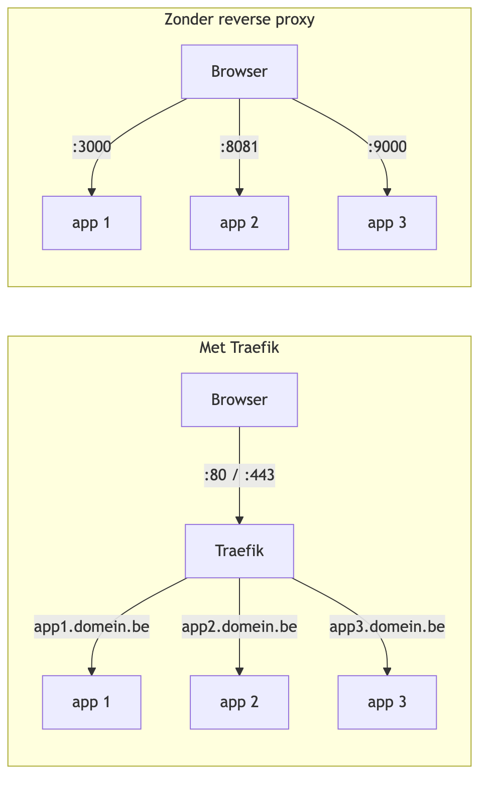

| Taak | Betekent |
|---|---|
| **Routeren** | `app1.domein.be` → container A, `app2.domein.be` → container B |
| **TLS-terminatie** | HTTPS stopt bij de proxy, de containers praten gewoon HTTP |
| **Load balancing** | 3 kopieën van een app? De proxy verdeelt de requests |
| **Middlewares** | headers toevoegen, login vragen, rate limiting, redirects |
| **Afschermen** | containers hebben geen `ports:`, enkel de proxy is publiek |

### Waarom Traefik?

Met **Nginx** schrijf je per app een `server { ... }`-blok, regel je certificaten zelf met certbot en doe je `nginx -s reload` na elke wijziging (zie [Nginx.md](Nginx.md)).

**Traefik** leest de **Docker API**. Start je een container met de juiste **labels**, dan:

- ziet Traefik de container meteen verschijnen
- maakt hij zelf de route aan, **zonder herstart**
- vraagt hij zelf een **Let's Encrypt**-certificaat aan en vernieuwt het
- toont hij alles in een **dashboard**

De configuratie van een app zit dus bij de app (in haar `compose.yaml`), niet in een centraal bestand.

## De bouwstenen

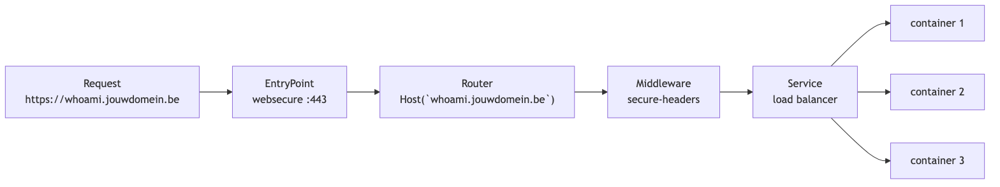

| Bouwsteen | Vraag die hij beantwoordt | In ons voorbeeld |
|---|---|---|
| **EntryPoint** | op welke poort komt het binnen? | `web` (:80), `websecure` (:443) |
| **Router** | is dit request voor mij? | ``Host(`whoami.jouwdomein.be`)`` |
| **Middleware** | moet er iets aan het request of antwoord veranderen? | security headers |
| **Service** | naar welke container(s) gaat het? | 3 × whoami |

### Statische en dynamische configuratie

| | Wat | Waar | Wijzigen |
|---|---|---|---|
| **Statisch** | entrypoints, certificaten, providers, dashboard | `traefik.yaml` | `docker compose restart traefik` |
| **Dynamisch** | routers, middlewares, services | **labels** op je containers | `docker compose up -d` van die app, Traefik volgt vanzelf |

Een **provider** levert de dynamische configuratie aan Traefik: `docker` (labels), `kubernetes` (Ingress-objecten, zie [ingress.md](ingress.md)), `file` (YAML-bestanden), ...

## Labels: hoe Traefik je containers vindt

Traefik krijgt `/var/run/docker.sock` mee (read-only) en ziet zo elke container die start of stopt.

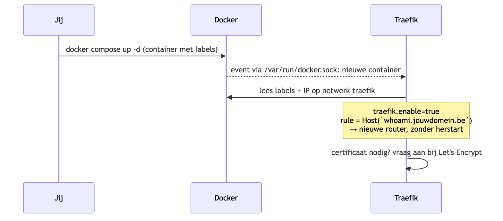

```yaml
labels:
  - "traefik.enable=true"
  - "traefik.http.routers.nginx.rule=Host(`test.jouwdomein.be`)"
  - "traefik.http.routers.nginx.entrypoints=websecure"
```

Een label lees je van links naar rechts: `traefik` . `http` . `routers` . **`nginx`** . `rule` is de **regel** van een HTTP-**router** met de zelfgekozen naam **nginx**.

- `traefik.enable=true` is nodig, want in `traefik.yaml` staat `exposedByDefault: false`
- rond de hostnaam staan **backticks**, geen gewone quotes
- `entrypoints=websecure`: de router luistert enkel op poort 443
- de routernaam kies je vrij, maar hij moet **uniek zijn op de server**. Twee apps met `routers.web` overschrijven elkaar

### Regels

```yaml
# één hostnaam
- "traefik.http.routers.shop.rule=Host(`shop.jouwdomein.be`)"
# twee hostnamen
- "traefik.http.routers.shop.rule=Host(`jouwdomein.be`) || Host(`www.jouwdomein.be`)"
# hostnaam + pad: frontend en API op hetzelfde domein
- "traefik.http.routers.api.rule=Host(`shop.jouwdomein.be`) && PathPrefix(`/api`)"
```

Matchen meerdere routers hetzelfde request, dan wint de **langste regel**: `/api` gaat voor op een router met enkel ``Host(`shop.jouwdomein.be`)``. Wil je het zelf bepalen: `traefik.http.routers.api.priority=10`.

### De poort van de container

Traefik neemt de poort uit `EXPOSE` van het image (nginx: 80). Heeft het image geen of meerdere poorten, zeg het dan zelf:

```yaml
- "traefik.http.services.mijnapp.loadbalancer.server.port=3000"
```

## De server klaarzetten

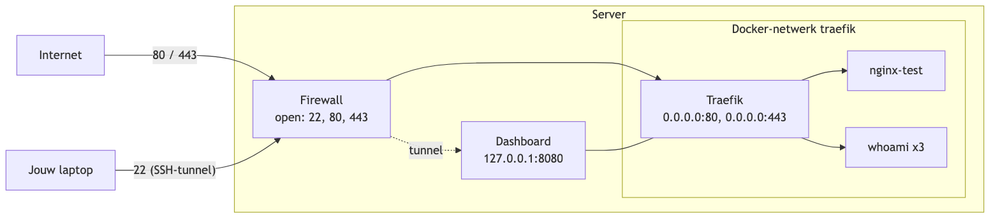

Je hebt nodig:

- een Linux-server met een **publiek IP**
- een **domeinnaam** waarvan je de DNS beheert
- firewall open voor **22, 80 en 443**
- Docker: `curl -fsSL https://get.docker.com | sudo sh`

Het volledige stappenplan (DNS, firewall, Docker, kopiëren, aanpassen, starten) staat in [traefik-examples/README.md](traefik-examples/README.md).

### DNS

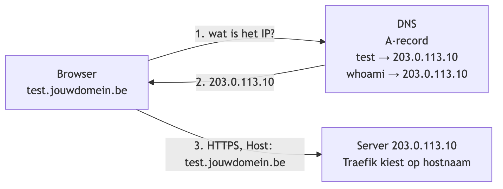

Per app een **A-record** naar het IP van je server, of één wildcard-record `*.jouwdomein.be`. Controleer met `dig +short test.jouwdomein.be` vóór je Traefik start: zonder DNS geen certificaat.

### Firewall: Docker en ufw

```bash
sudo ufw allow 22,80,443/tcp
sudo ufw enable
```

**Valkuil:** `ufw` beschermt **geen** poorten die Docker publiceert. Docker zet zijn eigen iptables-regels, en die worden vóór die van ufw bekeken. Daarom:

```yaml
ports:
  - "8080:8080"             # publiek op het internet, ufw of niet!
  - "127.0.0.1:8080:8080"   # enkel bereikbaar vanop de server zelf
```

## De configuratie

```
traefik-examples/
├── traefik/
│   ├── compose.yaml     Traefik + nginx-testsite
│   ├── traefik.yaml     configuratie van Traefik zelf
│   └── html/index.html  testpagina
└── whoami/
    └── compose.yaml     tweede app: 3 replica's + middleware
```

### `traefik.yaml`

```yaml
api:
  dashboard: true
  insecure: true

entryPoints:
  web:
    address: ":80"
    http:
      redirections:
        entryPoint:
          to: websecure
          scheme: https
  websecure:
    address: ":443"
    http:
      tls:
        certResolver: letsencrypt

certificatesResolvers:
  letsencrypt:
    acme:
      email: jouw.naam@student.vives.be # <-- WIJZIG
      storage: /letsencrypt/acme.json
      httpChallenge:
        entryPoint: web
  letsencrypt-staging:
    acme:
      email: jouw.naam@student.vives.be # <-- WIJZIG
      storage: /letsencrypt/acme-staging.json
      caServer: https://acme-staging-v02.api.letsencrypt.org/directory
      httpChallenge:
        entryPoint: web

providers:
  docker:
    exposedByDefault: false
    network: traefik

log:
  level: INFO

accessLog: {}
```

- **`api.insecure: true`**: het dashboard draait zonder login op poort 8080 (entrypoint `traefik`). Dat kan enkel omdat die poort niet publiek is, zie [het dashboard](#het-dashboard-via-een-ssh-tunnel)
- **`web`**: poort 80 stuurt alles door naar HTTPS (`308 Permanent Redirect`). De Let's Encrypt-challenge op poort 80 blijft werken: Traefik behandelt die vóór de redirect
- **`websecure`**: door `certResolver` op het entrypoint krijgt **elke** router op 443 automatisch een certificaat. Je apps hebben geen TLS-labels nodig
- **`storage`**: Traefik maakt `acme.json` zelf aan met de juiste rechten (600). Je hoeft het bestand niet zelf te maken
- **`staging`** gebruikt een eigen bestand: staging- en productiecertificaten mogen niet in hetzelfde bestand
- **`network: traefik`**: zit een container op meerdere netwerken, dan gebruikt Traefik dit netwerk om hem te bereiken

### `compose.yaml`

```yaml
services:
  traefik:
    image: traefik:v3.7
    container_name: traefik
    restart: unless-stopped
    ports:
      - "80:80"
      - "443:443"
      - "127.0.0.1:8080:8080"
    volumes:
      - ./traefik.yaml:/etc/traefik/traefik.yaml:ro
      - ./letsencrypt:/letsencrypt
      - /var/run/docker.sock:/var/run/docker.sock:ro
    networks:
      - traefik

  nginx:
    image: nginx:alpine
    container_name: nginx-test
    restart: unless-stopped
    volumes:
      - ./html:/usr/share/nginx/html:ro
    labels:
      - "traefik.enable=true"
      - "traefik.http.routers.nginx.rule=Host(`test.jouwdomein.be`)" # <-- WIJZIG
      - "traefik.http.routers.nginx.entrypoints=websecure"
    networks:
      - traefik

networks:
  traefik:
    external: true
```

- **vaste versie** (`v3.7`), geen `latest`. Oude versies zoals `v2.10` kunnen niet praten met Docker 29: de Docker provider logt dan enkel `Error response from daemon` en er komen geen routes
- `/etc/traefik/traefik.yaml` is een van de plaatsen waar Traefik zijn configuratie standaard zoekt, dus geen `command:` nodig
- `./letsencrypt` is een **map**: certificaten overleven een herstart of `docker compose down`
- nginx heeft **geen `ports:`**. Traefik bereikt hem over het netwerk `traefik`
- het netwerk is **`external`**: één gedeeld netwerk waar Traefik en al je apps (ook uit andere compose-projecten) op zitten. Eén keer aanmaken met `docker network create traefik`

### Starten

```bash
docker network create traefik
cd ~/traefik-examples/traefik
docker compose up -d
docker compose logs -f traefik
```

Surf naar `https://test.jouwdomein.be`. Het slotje toont een certificaat van Let's Encrypt.

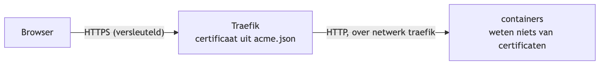

## HTTPS met Let's Encrypt

### De HTTP-challenge

Let's Encrypt geeft enkel een certificaat als je bewijst dat het domein van jou is:

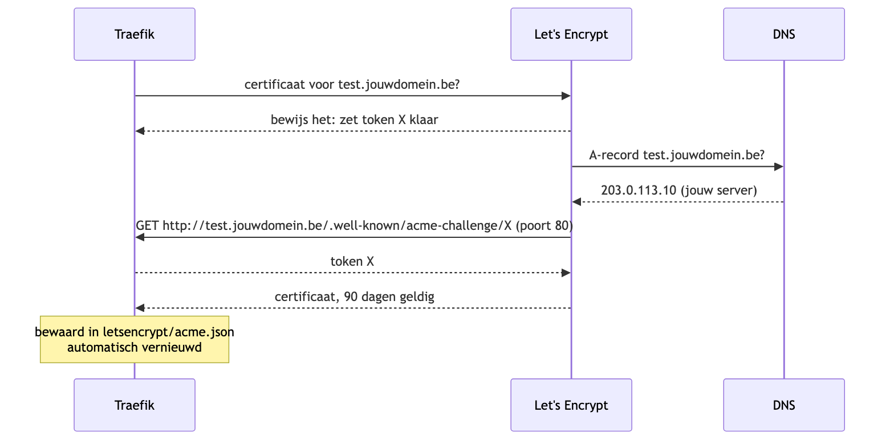

Daarom moeten **DNS kloppen** en **poort 80 open staan**, ook al surft niemand op HTTP. Het certificaat is 90 dagen geldig, Traefik vernieuwt het automatisch (30 dagen voor het verloopt).

### Productie of staging

| | `letsencrypt` | `letsencrypt-staging` |
|---|---|---|
| Browser vertrouwt het | ja | nee (waarschuwing) |
| Rate limits | o.a. 5 mislukte validaties per uur per hostnaam, 50 certificaten per week per domein | ruim |
| Gebruik | standaard | als je blijft proberen en het blijft mislukken |

Wisselen: in `traefik.yaml` bij `websecure` de `certResolver` aanpassen, dan `docker compose restart traefik`.

### DNS-challenge en wildcards

Kan poort 80 niet open (bv. een server enkel in een intern netwerk), of wil je één **wildcard-certificaat** `*.jouwdomein.be`, dan gebruik je de DNS-challenge: Traefik zet zelf een TXT-record via de API van je DNS-provider. Voorbeeld met Cloudflare:

```yaml
# traefik.yaml
certificatesResolvers:
  cloudflare:
    acme:
      email: jouw.naam@student.vives.be
      storage: /letsencrypt/acme-cloudflare.json
      dnsChallenge:
        provider: cloudflare
```

```yaml
# compose.yaml, bij de traefik-service
environment:
  - CF_DNS_API_TOKEN=${CF_DNS_API_TOKEN}   # uit een .env-bestand, niet in git
```

```yaml
# labels van een app
- "traefik.http.routers.app.tls.certresolver=cloudflare"
- "traefik.http.routers.app.tls.domains[0].main=jouwdomein.be"
- "traefik.http.routers.app.tls.domains[0].sans=*.jouwdomein.be"
```

## Het dashboard via een SSH-tunnel

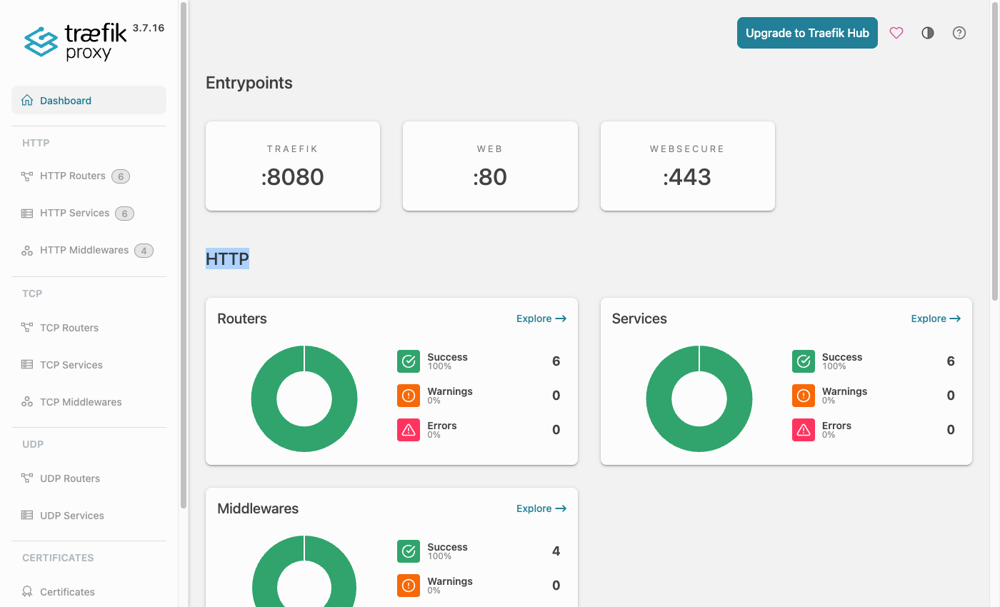

Het dashboard toont alle routers, services en middlewares, met hun status (groen = OK, rood = fout). Het heeft **geen login**. Daarom luistert het enkel op `127.0.0.1:8080` van de server, en open je **geen** poort in de firewall. Je bereikt het via een SSH-tunnel:

```bash
ssh -L 8080:localhost:8080 gebruiker@203.0.113.10
```

Laat dat venster open en surf **op je laptop** naar <http://localhost:8080/dashboard/>.

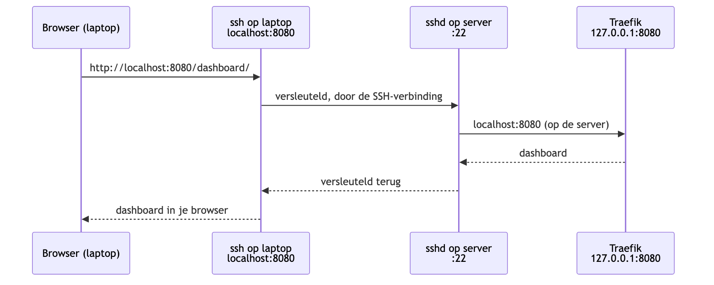

`-L 8080:localhost:8080` lees je als: poort **8080 op je laptop** → door de SSH-verbinding → naar **localhost:8080 zoals de server het ziet**. Het verkeer is versleuteld door SSH, en wie geen SSH-toegang heeft, komt niet aan het dashboard.

Vast in `~/.ssh/config` op je laptop:

```
Host traefik
    HostName 203.0.113.10
    User gebruiker
    LocalForward 8080 localhost:8080
```

```bash
ssh traefik        # shell + tunnel
ssh -N traefik     # enkel de tunnel, geen shell
```

Is poort 8080 op je laptop al bezet: `LocalForward 9090 localhost:8080` en surf naar `localhost:9090/dashboard/`.

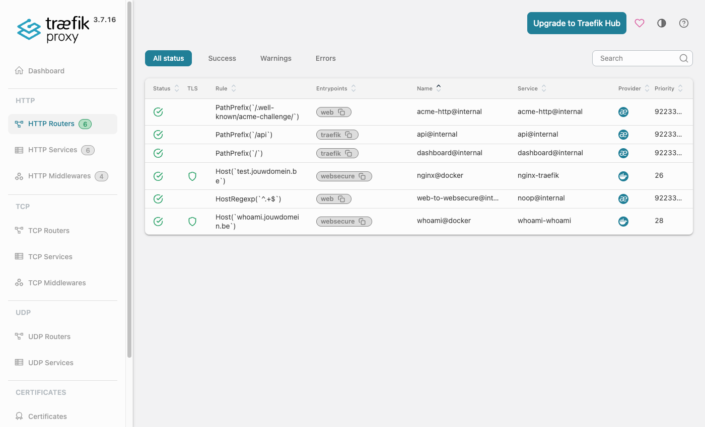

In de lijst met routers: `@docker` komt uit labels, `@internal` maakt Traefik zelf (dashboard, de HTTP→HTTPS-redirect, de ACME-challenge).

De API achter het dashboard kun je ook met `curl` gebruiken, op de server of door de tunnel:

```bash
curl -s localhost:8080/api/http/routers | jq '.[] | {name, rule, status}'
curl -s localhost:8080/api/http/services | jq '.[] | {name, status}'
```

## Meer apps

### Een tweede app in een eigen project

Elke app mag in een eigen map met een eigen `compose.yaml`, zolang ze op het netwerk `traefik` zit. Traefik hoef je daarvoor **niet** te herstarten.

```yaml
# traefik-examples/whoami/compose.yaml
services:
  whoami:
    image: traefik/whoami:v1.11
    deploy:
      replicas: 3
    restart: unless-stopped
    labels:
      - "traefik.enable=true"
      - "traefik.http.routers.whoami.rule=Host(`whoami.jouwdomein.be`)" # <-- WIJZIG
      - "traefik.http.routers.whoami.entrypoints=websecure"
      - "traefik.http.middlewares.secure-headers.headers.stsSeconds=31536000"
      - "traefik.http.middlewares.secure-headers.headers.contentTypeNosniff=true"
      - "traefik.http.middlewares.secure-headers.headers.frameDeny=true"
      - "traefik.http.routers.whoami.middlewares=secure-headers"
    networks:
      - traefik

networks:
  traefik:
    external: true
```

```bash
cd ~/traefik-examples/whoami
docker compose up -d
```

### Load balancing

`whoami` toont de hostnaam van de container die antwoordt. Ververs `https://whoami.jouwdomein.be` een paar keer:

```
Hostname: 48b0270ed6f1
Hostname: ee83ebe69343
Hostname: 5fac2310129c
```

Containers met dezelfde labels vormen **één service met meerdere servers**. Traefik verdeelt de requests round-robin. Opschalen kan live:

```bash
docker compose up -d --scale whoami=5
```

### Middlewares

Een middleware **definieer** je (`middlewares.<naam>.<type>.<optie>`) en **koppel** je aan een router (`routers.<router>.middlewares=<naam>`). Meerdere middlewares worden in volgorde uitgevoerd.

```yaml
labels:
  # Login met gebruikersnaam en wachtwoord
  - "traefik.http.middlewares.login.basicauth.users=admin:$$2y$$05$$..."
  # Gemiddeld max 10 requests per seconde per IP
  - "traefik.http.middlewares.rl.ratelimit.average=10"
  # Enkel vanaf bepaalde IP-adressen (anders 403)
  - "traefik.http.middlewares.allow.ipallowlist.sourcerange=203.0.113.0/24"
  # /api wegknippen voor de backend het request ziet
  - "traefik.http.middlewares.strip.stripprefix.prefixes=/api"

  - "traefik.http.routers.api.middlewares=allow,login,rl,strip"
```

Het wachtwoord voor `basicauth` is een bcrypt-hash. In een compose-bestand moet elke `$` verdubbeld worden tot `$$`, anders ziet compose het als een variabele:

```bash
docker run --rm httpd:2.4-alpine htpasswd -nbB admin geheim | sed 's/\$/$$/g'
```

> In Traefik v2 heette `ipallowlist` nog `ipwhitelist`. Oude voorbeelden op het internet werken dus niet meer in v3.

### Frontend en API op hetzelfde domein

```yaml
services:
  frontend:
    image: nginx:alpine
    labels:
      - "traefik.enable=true"
      - "traefik.http.routers.front.rule=Host(`shop.jouwdomein.be`)"
      - "traefik.http.routers.front.entrypoints=websecure"
    networks: [traefik]

  api:
    image: traefik/whoami:v1.11
    labels:
      - "traefik.enable=true"
      - "traefik.http.routers.api.rule=Host(`shop.jouwdomein.be`) && PathPrefix(`/api`)"
      - "traefik.http.routers.api.entrypoints=websecure"
      - "traefik.http.middlewares.strip.stripprefix.prefixes=/api"
      - "traefik.http.routers.api.middlewares=strip"
    networks: [traefik]

networks:
  traefik:
    external: true
```

`https://shop.jouwdomein.be/` gaat naar nginx, `https://shop.jouwdomein.be/api/hello` gaat naar de API, die `/hello` ontvangt.

### Netwerken: de database blijft binnen

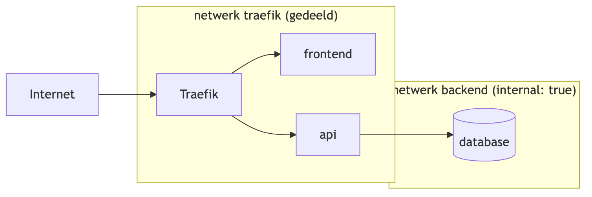

```yaml
services:
  api:
    image: mijn-api
    labels:
      - "traefik.enable=true"
      - "traefik.http.routers.mijnapi.rule=Host(`api.jouwdomein.be`)"
      - "traefik.http.routers.mijnapi.entrypoints=websecure"
    networks: [traefik, backend]

  db:
    image: mongo:7
    networks: [backend]        # geen labels, niet op traefik

networks:
  traefik:
    external: true
  backend:
    internal: true             # geen verkeer naar of van buiten
```

Traefik zit niet op `backend`, de database zit niet op `traefik`: van buitenaf is de database onbereikbaar. De `api` zit op beide netwerken, en dankzij `providers.docker.network: traefik` weet Traefik via welk netwerk hij de API moet bereiken.

## Fouten zoeken

Eerst kijken, dan gissen:

```bash
docker ps                                          # draait alles?
docker logs traefik 2>&1 | grep -E "ERR|acme"      # fouten en certificaten
docker inspect nginx-test | jq '.[0].Config.Labels' # kloppen de labels?
docker network inspect traefik | jq '.[0].Containers[].Name'  # zit de container op het netwerk?
curl -I https://test.jouwdomein.be
```

En het **dashboard**: staat je router erbij, en is hij groen?

| Symptoom | Oorzaak | Oplossing |
|---|---|---|
| `404 page not found` | Traefik kent geen router voor die hostnaam | `traefik.enable=true`? container op netwerk `traefik`? typfout in `Host()`? |
| `Bad Gateway` | router OK, maar de container is onbereikbaar | verkeerde poort: `loadbalancer.server.port` |
| browser: certificaat `TRAEFIK DEFAULT CERT` | Let's Encrypt gaf (nog) geen certificaat | logs bekijken, zie hieronder |
| log: `NXDOMAIN looking up A` | DNS-record ontbreekt | A-record aanmaken |
| log: `Invalid response from http://.../.well-known/acme-challenge/...: 404` of `Timeout during connect` | DNS wijst naar een ander IP, of poort 80 is dicht | `dig`, firewall |
| log: `rateLimited` / `too many certificates` | te vaak geprobeerd | tijdelijk `letsencrypt-staging` |
| log: `Error response from daemon` (docker provider) | Traefik te oud voor de Docker-versie | `image: traefik:v3.7` |
| `network traefik declared as external, but could not be found` | netwerk niet aangemaakt | `docker network create traefik` |
| dashboard: `connection refused` | SSH-tunnel niet open, of Traefik draait niet | `ssh -L 8080:localhost:8080 ...` |

Waarschuwingen (`WRN`) over *encoded characters* en *aliasHeadersStrategy* bij het opstarten zijn info voor speciale backends en mag je negeren.

Meer detail in de logs: in `traefik.yaml` `log.level: DEBUG`, dan `docker compose restart traefik`.

## In productie

- **Vaste versie** van het image, en bewust upgraden (lees de release notes)
- **Back-up van `letsencrypt/acme.json`**: daarin zitten je certificaten en je Let's Encrypt-account
- **Docker socket**: wie in de Traefik-container binnenraakt, kan via de socket Docker besturen. Mount hem `:ro` en overweeg een *socket proxy* (bv. `tecnativa/docker-socket-proxy`) die enkel leesrechten doorlaat
- **Dashboard**: niet publiek. Via een SSH-tunnel zoals hierboven, of achter een router met `basicauth` en `service=api@internal`
- **Logs beperken**:
  ```yaml
  services:
    traefik:
      logging:
        driver: json-file
        options:
          max-size: "10m"
          max-file: "3"
  ```

## Traefik en Kubernetes

Traefik is ook de Ingress controller uit [ingress.md](ingress.md). Hetzelfde programma, met een andere provider:

| | Docker | Kubernetes |
|---|---|---|
| Routes uit | labels op containers | Ingress-objecten |
| Installeren | `compose.yaml` | `helm install traefik traefik/traefik` |
| Certificaten | Traefik zelf (ACME) | meestal cert-manager |
| Netwerk | gedeeld netwerk `traefik` | Services (ClusterIP) |

Router, service, middleware en entrypoint zijn **dezelfde begrippen**.

## Traefik naast andere reverse proxies

| | Traefik | Nginx | Caddy | HAProxy |
|---|---|---|---|---|
| Configuratie | labels / Ingress, live | bestanden, reload | Caddyfile, reload | bestanden, reload |
| Auto-discovery Docker/K8s | ja | nee (extra tools) | via plugin | nee |
| Automatisch HTTPS | ja | nee (certbot) | ja | nee |
| Dashboard | ingebouwd | nee | nee | statistiekenpagina |
| Sterk in | containers, veel kleine apps | statische bestanden, raw performance | eenvoud | zware load balancing |

## Oefeningen

### Oefening 1: Traefik op je server

Volg [traefik-examples/README.md](traefik-examples/README.md) stap 1 tot 7:

- `https://test.<jouwdomein>` toont "Traefik werkt!" met een geldig certificaat
- `http://test.<jouwdomein>` stuurt door naar HTTPS (`curl -I`: `308`)
- het dashboard werkt via een SSH-tunnel, en `curl http://<server-ip>:8080` vanaf je laptop **faalt**

### Oefening 2: meerdere apps

- Start `whoami` (stap 8) en toon de load balancing
- Schaal naar 5 replica's zonder Traefik aan te raken
- Controleer de security headers met `curl -I https://whoami.<jouwdomein>`

### Oefening 3: je eigen app

Zet een eigen project (bv. de PetShelter uit [6c-minikube-demo](../06-Kubernetes/6c-minikube-demo/docker-compose.yml)) achter Traefik:

- frontend op `petshelter.<jouwdomein>`, API op `petshelter.<jouwdomein>/api`
- de database enkel op een `internal` netwerk
- de API achter een `ratelimit`, een admin-pagina achter `basicauth`
- geen enkele `ports:` behalve die van Traefik

## Referenties

- [Traefik-documentatie](https://doc.traefik.io/traefik/)
- [Docker provider: alle labels](https://doc.traefik.io/traefik/reference/install-configuration/providers/docker/)
- [Middlewares](https://doc.traefik.io/traefik/reference/routing-configuration/http/middlewares/overview/)
- [Let's Encrypt rate limits](https://letsencrypt.org/docs/rate-limits/)
- [Docker en ufw](https://docs.docker.com/engine/network/packet-filtering-firewalls/#docker-and-ufw)
