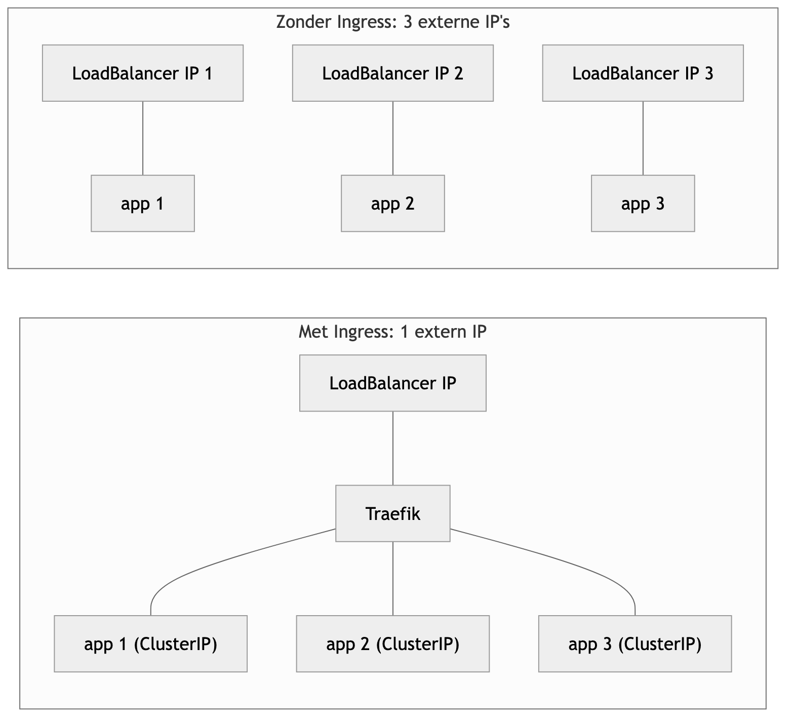
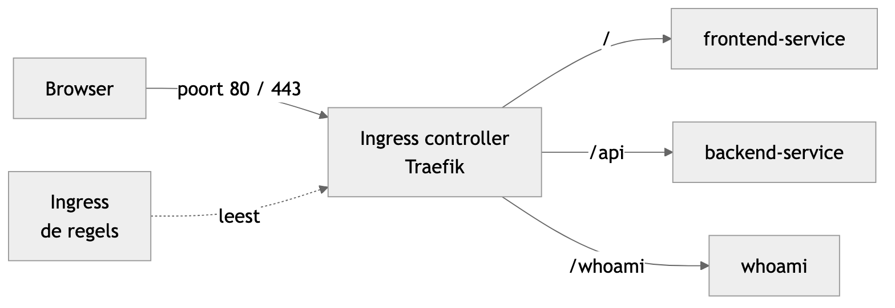
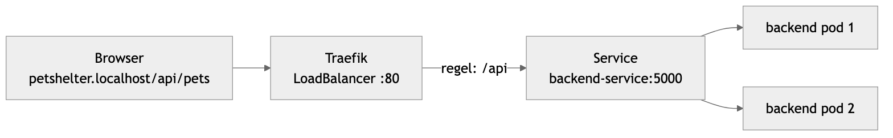
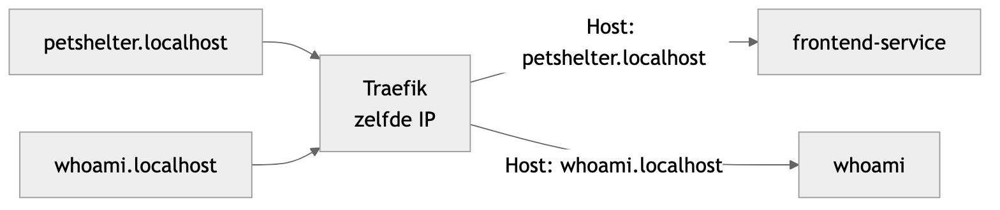
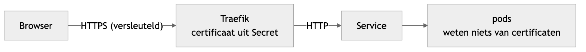
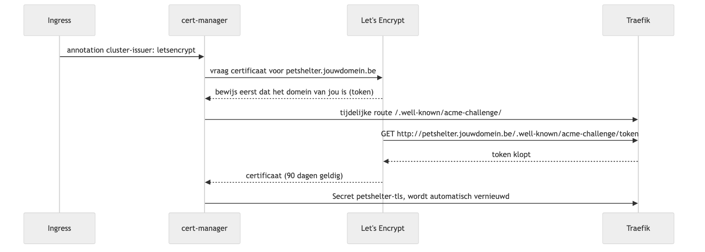

<!-- _class: lead -->

# Les 8 — Ingress

Al je apps bereikbaar via één ingang

Volledige uitgewerkte notities: [ingress.md](ingress.md) · YAML: [ingress-examples/](ingress-examples/)

---

## Agenda

1. Het probleem
2. Ingress en Ingress controller
3. Traefik installeren
4. Je eerste Ingress
5. Routeren op pad en hostnaam
6. HTTPS
7. Fouten zoeken

---

<!-- _class: lead -->

## 1. Het probleem

---

## Zo werkt geen echte website

<style scoped>section { font-size: 28px; }</style>

Tot nu toe: `http://<minikube-ip>:32500` of `kubectl port-forward`

- Niemand typt `:32500` in de adresbalk
- Elke app een eigen poort → 10 apps = 10 poorten
- Geen HTTPS, geen domeinnaam

Een echte website: **poort 80/443**, een **domeinnaam**,
en vaak meerdere apps achter één adres (`/` en `/api`)

---

## Service-types: wat je al kent

<style scoped>table { font-size: 24px; }</style>

| | Van buiten? | Gebruik |
|---|---|---|
| `ClusterIP` | nee | database, backend, alles achter een Ingress |
| `NodePort` | ja, poort 30000–32767 | snel testen |
| `LoadBalancer` | ja, eigen extern IP (kost geld) | **één keer**: voor de controller |
| **Ingress** | ja, poort 80/443 met regels | **al je webapps** achter één IP |

---

## Eén extern IP in plaats van veel



- Zonder Ingress: elke app een `LoadBalancer` → elk een extern IP, elk betalen
- Met Ingress: **één** `LoadBalancer` voor Traefik
- Je apps blijven gewone `ClusterIP`-Services

---

<!-- _class: lead -->

## 2. Ingress en Ingress controller

---

## Het onthaal van een gebouw

<style scoped>table { font-size: 25px; }</style>

| Gebouw | Kubernetes |
|---|---|
| de ene ingang | één IP-adres op poort 80/443 |
| de lijst aan het onthaal | **Ingress**: YAML met regels (`/api` → backend) |
| de onthaalmedewerker | **Ingress controller**: Traefik voert de regels uit |
| de kantoren | je **Services** en pods |

**Een Ingress zonder controller doet niets.**
Kubernetes heeft standaard geen controller: die installeer je zelf.

---

## Regels en controller



De controller **volgt de Kubernetes API**: nieuwe Ingress → meteen nieuwe route, zonder herstart

---

<!-- _class: lead -->

## 3. Traefik installeren

---

## Traefik op Minikube, met Helm

```bash
minikube start
helm repo add traefik https://traefik.github.io/charts
helm repo update
helm install traefik traefik/traefik -n traefik --create-namespace
```

```bash
kubectl get pods -n traefik       # traefik-xxxx  1/1  Running
kubectl get ingressclass          # traefik
kubectl get svc -n traefik        # LoadBalancer  EXTERNAL-IP <pending>
```

**IngressClass** `traefik` = "deze regels zijn voor Traefik"

---

## `<pending>` → `minikube tunnel`

<style scoped>section { font-size: 27px; }</style>

Minikube heeft geen cloud die een IP uitdeelt. In een **apart venster**, open laten:

```bash
minikube tunnel                   # vraagt je wachtwoord (poort 80/443)
kubectl get svc -n traefik        # EXTERNAL-IP 127.0.0.1
```

Traefik luistert nu op `http://localhost` en `https://localhost`

**Werkt het niet?** Altijd mogelijk, zonder admin-rechten:
`kubectl port-forward -n traefik svc/traefik 8080:80 8443:443`

---

## En `minikube addons enable ingress`?

<style scoped>section { font-size: 28px; }</style>

- Installeert **ingress-nginx** in plaats van Traefik
- Werkt, maar wordt sinds maart 2026 **niet meer onderhouden**
- Dan `ingressClassName: nginx` in je Ingress

Wij gebruiken **Traefik**: zelfde als in de Final, standaard in k3s

---

<!-- _class: lead -->

## 4. Je eerste Ingress

---

## De app deployen

```bash
kubectl apply -f ../06-Kubernetes/6c-minikube-demo/k8s/
kubectl apply -f ingress-examples/whoami.yaml
kubectl get svc
```

| Service | Poort |
|---|---|
| `frontend-service` | 3000 |
| `backend-service` | 5000 |
| `whoami` (3 replicas, toont de podnaam) | 80 |

Noteer **namen en poorten**: die komen in je Ingress

---

## 01-basic.yaml

<style scoped>pre { font-size: 0.75em; }</style>

```yaml
apiVersion: networking.k8s.io/v1
kind: Ingress
metadata:
  name: petshelter
spec:
  ingressClassName: traefik
  rules:
    - http:
        paths:
          - path: /
            pathType: Prefix
            backend:
              service:
                name: frontend-service
                port:
                  number: 3000
```

---

## Wat staat erin?

<style scoped>section { font-size: 28px; }</style>

- `ingressClassName: traefik`: welke controller de regels uitvoert
- geen `host` → geldt voor **elke** hostnaam
- `path: /` + `pathType: Prefix` → alle paden
- `service` + `port`: de **Service-poort**, niet de NodePort

```bash
kubectl apply -f ingress-examples/01-basic.yaml
kubectl get ingress
curl http://localhost/          # de PetShelter-frontend, zonder poortnummer
```

---

<!-- _class: lead -->

## 5. Routeren op pad en hostnaam

---

## Op pad: 02-paths.yaml

<style scoped>pre { font-size: 0.75em; }</style>

```yaml
  rules:
    - http:
        paths:
          - path: /api
            pathType: Prefix
            backend:
              service:
                name: backend-service
                port: { number: 5000 }
          - path: /whoami          # ... naar whoami:80
          - path: /                # ... naar frontend-service:3000
```

```bash
curl http://localhost/api/pets     # JSON van de backend
curl http://localhost/whoami       # whoami
curl http://localhost/             # de frontend
```

---

## Zo loopt een request

<style scoped>section { font-size: 27px; } table { font-size: 24px; }</style>



- **Langste pad wint**, de volgorde in het bestand maakt niet uit
- Het pad gaat **ongewijzigd** door: de backend krijgt `/api/pets`

| `pathType` | `path: /api` past bij |
|---|---|
| `Prefix` | `/api`, `/api/`, `/api/pets`, niet `/apix` |
| `Exact` | enkel `/api` |

---

## Load balancing zien

```bash
for i in 1 2 3 4 5 6; do curl -s http://localhost/whoami | grep Hostname; done
```

```
Hostname: whoami-85f6bb67d6-h694t
Hostname: whoami-85f6bb67d6-wqm99
Hostname: whoami-85f6bb67d6-khgd5
...
```

De controller verdeelt over **alle pods**

Zo werkt ook de `/nodeinfo`-controle van de Final: **3 verschillende nodes**

---

## Op hostnaam: 03-hosts.yaml



```bash
curl http://petshelter.localhost/      # frontend
curl http://whoami.localhost/          # whoami
curl http://localhost/                 # 404: geen regel past
```

Traefik kijkt naar de header **`Host:`** · `*.localhost` = altijd `127.0.0.1`

---

## Andere namen testen

<style scoped>section { font-size: 28px; }</style>

`/etc/hosts` (Windows: `C:\Windows\System32\drivers\etc\hosts`):

```
127.0.0.1  petshelter.local
```

Of de `Host`-header zelf meesturen:

```bash
curl -H "Host: whoami.localhost" http://127.0.0.1/
```

Pad en host combineren: `mijnsite.be` met `/` → frontend, `/api` → backend

---

<!-- _class: lead -->

## 6. HTTPS

---

## TLS-termination



- De **controller** heeft het certificaat en ontsleutelt
- Certificaat in een **Secret** van het type `tls`
- Je app hoeft niets van certificaten te weten

---

## Lokaal: eigen certificaat

<style scoped>pre { font-size: 0.75em; }</style>

```bash
openssl req -x509 -nodes -newkey rsa:2048 -days 365 \
  -keyout tls.key -out tls.crt \
  -subj "/CN=petshelter.localhost" -addext "subjectAltName=DNS:petshelter.localhost"
kubectl create secret tls petshelter-tls --cert=tls.crt --key=tls.key
```

```yaml
spec:
  tls:
    - hosts: [petshelter.localhost]
      secretName: petshelter-tls
```

```bash
curl -k https://petshelter.localhost/      # -k: zelf ondertekend
```

Browser: "niet veilig" (logisch) · `tls.key` nooit in git

---

## In de cloud: Let's Encrypt + cert-manager



Vereist: je domein wijst naar het `EXTERNAL-IP` van Traefik

---

## cert-manager instellen

<style scoped>pre { font-size: 0.75em; }</style>

```bash
helm repo add jetstack https://charts.jetstack.io
helm install cert-manager jetstack/cert-manager \
  -n cert-manager --create-namespace --set crds.enabled=true
kubectl apply -f ingress-examples/cluster-issuer.yaml   # letsencrypt: READY True
```

```yaml
metadata:
  annotations:
    cert-manager.io/cluster-issuer: letsencrypt
spec:
  tls:
    - hosts: [petshelter.jouwdomein.be]
      secretName: petshelter-tls         # maakt cert-manager zelf
```

```bash
kubectl get certificate                  # READY True na 1-2 minuten
```

---

<!-- _class: lead -->

## 7. Fouten zoeken

---

## Van buiten naar binnen

```bash
kubectl get pods,svc -n traefik          # 1. controller + EXTERNAL-IP?
kubectl get ingress                      # 2. juiste CLASS en HOSTS?
kubectl describe ingress petshelter      #    backends juist?
kubectl describe svc frontend-service    # 3. Endpoints leeg = geen pods
kubectl get pods                         # 4. Running en Ready?
kubectl logs -n traefik deploy/traefik   # wat zegt Traefik?
```

`ADDRESS` leeg bij `kubectl get ingress` op Minikube = normaal

---

## Wat je ziet → oorzaak

<style scoped>table { font-size: 21px; }</style>

| Wat je ziet | Oorzaak |
|---|---|
| geen verbinding | `EXTERNAL-IP <pending>`: `minikube tunnel` vergeten, of verkeerde poort |
| `404 page not found` (Traefik) | geen regel past: host, pad, `ingressClassName`, of Service/poort bestaat niet (zie logs) |
| `503 no available server` | Service klopt, maar geen werkende pods |
| 404-pagina **van je app** | request komt aan, maar je app kent dat pad niet |
| `TRAEFIK DEFAULT CERT` | TLS-Secret niet gevonden: naam of namespace |
| Service in andere namespace | Ingress verwijst enkel naar Services in **zijn eigen** namespace |

---

## Commando's

<style scoped>table { font-size: 23px; }</style>

| Commando | Wat |
|---|---|
| `kubectl get ingress` (kort: `ing`) | Ingresses met class, hosts, adres |
| `kubectl describe ingress <naam>` | regels en backends |
| `kubectl get ingressclass` | welke controllers |
| `kubectl get svc -n traefik` | extern IP van de controller |
| `kubectl logs -n traefik deploy/traefik` | logs van Traefik |
| `kubectl create secret tls …` | TLS-Secret |
| `kubectl get certificate` | certificaten van cert-manager |
| `minikube tunnel` | LoadBalancer-IP op Minikube |

---

## Volgende stappen

- [Ingress Advanced](ingress-advanced.md): controller intern, cert-manager in detail, Traefik in productie, middlewares (login, rate limiting), Gateway API
- **Helm**: de Ingress in je chart, host per omgeving in `values-test.yaml` / `values-prod.yaml`
- **Final**: echte cluster, eigen domein, Let's Encrypt, route `/nodeinfo`
