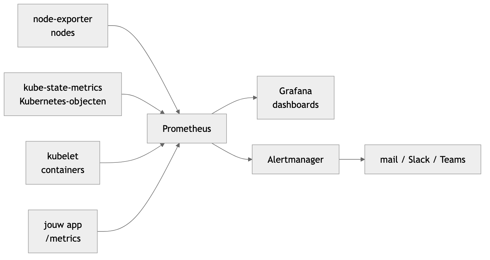

<!-- _class: lead -->

# Les 12 — Monitoring

Prometheus en Grafana met één Helm-commando

Volledige uitgewerkte notities: [prometheus-grafana-helm.md](prometheus-grafana-helm.md) · YAML: [kube-prometheus-stack/](kube-prometheus-stack/)

---

## Agenda

1. Het probleem
2. Het idee: metrics ophalen
3. De stack installeren
4. Prometheus en PromQL
5. Grafana
6. Je eigen app monitoren
7. Alerts
8. Van buiten de cluster monitoren
9. Fouten zoeken

---

<!-- _class: lead -->

## 1. Het probleem

---

## `kubectl` toont enkel *nu*

<style scoped>section { font-size: 28px; }</style>

`kubectl get pods`, `kubectl top`: de toestand **op dit moment**. Maar:

- Sinds wanneer gebruikt die pod zoveel geheugen?
- Is de schijf van een node binnen een week vol?
- Hoeveel requests/s krijgt mijn backend, en hoeveel fouten?
- Ligt er iets plat **voordat** een gebruiker het meldt?

Monitoring = cijfers **verzamelen**, **bewaren**, **tonen** en **waarschuwen**

---

## De oplossing: kube-prometheus-stack

<style scoped>table { font-size: 25px; }</style>

Eén Helm chart, alles erin:

| Wat | Tool |
|---|---|
| cijfers verzamelen en bewaren | **Prometheus** |
| dashboards | **Grafana** (een dertigtal klaar) |
| meldingen versturen | **Alertmanager** (100+ regels klaar) |
| cijfers van nodes en Kubernetes | exporters |

---

<!-- _class: lead -->

## 2. Het idee: metrics ophalen

---

## Metrics, logs en traces

<style scoped>table { font-size: 24px; }</style>

| | Wat | Voorbeeld | Tool |
|---|---|---|---|
| **Metrics** | getallen over de tijd | 42 requests/s, 310 MB | **Prometheus** |
| **Logs** | tekstregels | `ERROR database timeout` | `kubectl logs`, Loki |
| **Traces** | weg van één request | frontend → backend → db | Jaeger, Tempo |

Vandaag: **metrics**. Goedkoop, makkelijk in grafieken, ideaal voor alerts

---

## Hoe ziet een metric eruit?

<style scoped>section { font-size: 27px; }</style>

Je app toont een gewone pagina **`/metrics`**: `curl localhost:9898/metrics` (ingekort)

```
# TYPE http_requests_total counter
http_requests_total{status="200"} 214
http_requests_total{status="404"} 3
# TYPE process_resident_memory_bytes gauge
process_resident_memory_bytes 2.4576e+07
```

**naam** + **labels** `{}` + **waarde**
Elke combinatie = een **tijdreeks**: elke 30 s een nieuw punt

---

## Counter en gauge

<style scoped>table { font-size: 25px; }</style>

| Type | Gedrag | Voorbeeld | Lezen |
|---|---|---|---|
| **counter** | enkel omhoog (0 na herstart) | requests, CPU-seconden | met **`rate()`** |
| **gauge** | op en neer | geheugen, aantal pods | rechtstreeks |

"1.204.311 requests sinds de start": zegt weinig
"40 requests **per seconde**, nu": dat is `rate()` op een counter

---

## Pull: Prometheus haalt op



<style scoped>section { font-size: 27px; }</style>

- Je app **stuurt niets**
- Prometheus vraagt elke 30 s `/metrics` op bij elk **target** (*scrapen*)
- Target onbereikbaar → `up` = `0`
- Grafana en Alertmanager **vragen** aan Prometheus

---

<!-- _class: lead -->

## 3. De stack installeren

---

## Eén Helm-commando

<style scoped>pre { font-size: 0.7em; }</style>

```bash
minikube start --memory=4g --cpus=2

helm repo add prometheus-community https://prometheus-community.github.io/helm-charts
helm repo update

helm upgrade --install monitoring prometheus-community/kube-prometheus-stack \
  -n monitoring --create-namespace \
  -f ../07-Helm/prometheus-grafana/monitoring-values.yaml

kubectl get pods -n monitoring          # na 2 à 3 minuten alles Running
```

Values: Grafana-wachtwoord `devops123`, 7 dagen bewaren (5Gi), control plane-targets uit

---

## Wat zit erin?

<style scoped>table { font-size: 22px; }</style>

| Onderdeel | Wat |
|---|---|
| **Prometheus** | haalt `/metrics` op bij alle targets en bewaart ze |
| **node-exporter** | CPU, geheugen, schijf, netwerk per node (DaemonSet) |
| **kube-state-metrics** | Kubernetes-objecten: replicas, pods niet Ready, … |
| **kubelet / cAdvisor** | CPU en geheugen per container |
| **Grafana** | dashboards bovenop Prometheus |
| **Alertmanager** | verstuurt alerts (mail, Slack, Teams) |
| **Prometheus Operator** | `ServiceMonitor` en `PrometheusRule` → Prometheus-config |

---

<!-- _class: lead -->

## 4. Prometheus en PromQL

---

## Prometheus openen

```bash
kubectl port-forward -n monitoring svc/monitoring-kube-prometheus-prometheus 9090:9090
```

http://localhost:9090

- *Status → Targets*: alles wat Prometheus ophaalt, `UP` of `DOWN`
- *Query*: PromQL uitvoeren, als **tabel** of **grafiek**

---

## Queries om te proberen

<style scoped>table { font-size: 20px; }</style>

| Query | Wat |
|---|---|
| `up` | 1 = bereikbaar, 0 = down |
| `sum by (namespace) (kube_pod_info)` | pods per namespace |
| `kube_deployment_status_replicas_available` | replicas per Deployment |
| `sum by (pod) (rate(container_cpu_usage_seconds_total{namespace="monitoring"}[5m]))` | CPU per pod (cores) |
| `sum by (pod) (container_memory_working_set_bytes{namespace="monitoring", container!=""})` | geheugen per pod |
| `100 * (1 - avg(rate(node_cpu_seconds_total{mode="idle"}[5m])))` | CPU van de nodes in % |
| `ALERTS{alertstate="firing"}` | alerts die nu afgaan |

---

## Een query lezen: van binnen naar buiten

<style scoped>section { font-size: 27px; }</style>

```
1.                    container_cpu_usage_seconds_total{namespace="monitoring"}
2.              rate(                                                       [5m])
3. sum by (pod) (                                                                )
```

- `{namespace="monitoring"}`: enkel tijdreeksen met dat **label**
- `rate(…[5m])`: hoe snel stijgt een **counter**? (`_total` → `rate`)
- `sum by (pod)`: optellen per pod

---

<!-- _class: lead -->

## 5. Grafana

---

## Grafana openen

<style scoped>pre { font-size: 0.72em; }</style>

```bash
kubectl port-forward -n monitoring svc/monitoring-grafana 3000:80
```

http://localhost:3000 · `admin` / `devops123`

Zonder values-bestand:

```bash
kubectl get secret -n monitoring monitoring-grafana \
  -o jsonpath="{.data.admin-password}" | base64 -d; echo
```

Grafana bewaart **geen** metrics: elk paneel = een PromQL-query aan Prometheus

---

## Kant-en-klare dashboards

<style scoped>table { font-size: 24px; }</style>

| Dashboard | Wat je ziet |
|---|---|
| *Kubernetes / Compute Resources / Cluster* | CPU en geheugen per namespace |
| *… / Namespace (Pods)* | CPU en geheugen per pod |
| *… / Pod* | één pod, per container |
| *Node Exporter / Nodes* | CPU, geheugen, schijf, netwerk per node |
| *Kubernetes / Persistent Volumes* | hoe vol je volumes zijn |

Eigen dashboard: *New dashboard → Add visualization → Prometheus* → query plakken

---

## Grafana via Ingress

<style scoped>pre { font-size: 0.72em; }</style>

Met Traefik uit les 8: de chart maakt de Ingress zelf

```yaml
grafana:
  ingress:
    enabled: true
    ingressClassName: traefik
    hosts:
      - grafana.localhost
```

```bash
helm upgrade monitoring prometheus-community/kube-prometheus-stack -n monitoring \
  --reuse-values -f kube-prometheus-stack/grafana-ingress.yaml
```

http://grafana.localhost (met `minikube tunnel`)

---

<!-- _class: lead -->

## 6. Je eigen app monitoren

---

## podinfo: een app met `/metrics`

```bash
helm repo add podinfo https://stefanprodan.github.io/podinfo
helm install podinfo podinfo/podinfo

kubectl port-forward svc/podinfo 9898:9898          # apart venster
curl -s localhost:9898/metrics | grep http_requests_total
```

Dit leest Prometheus straks. Maar **hoe weet Prometheus dat podinfo bestaat?**

---

## ServiceMonitor

<style scoped>pre { font-size: 0.72em; }</style>

```yaml
apiVersion: monitoring.coreos.com/v1
kind: ServiceMonitor
metadata:
  name: podinfo
  labels:
    release: monitoring          # verplicht!
spec:
  selector:
    matchLabels:
      app.kubernetes.io/name: podinfo   # welke Service
  endpoints:
    - port: http                 # NAAM van de poort in de Service
      path: /metrics
      interval: 15s
```

```bash
kubectl apply -f kube-prometheus-stack/podinfo-servicemonitor.yaml
```

---

## Hoe vindt Prometheus je app?

<style scoped>section { font-size: 26px; } pre { font-size: 0.72em; }</style>

```
ServiceMonitor   label release: monitoring   ← anders negeert Prometheus hem
      ▼
Service          app.kubernetes.io/name: podinfo, poort "http"
      ▼
pods             Prometheus haalt /metrics op bij elke pod
```

```bash
kubectl get prometheus -n monitoring -o jsonpath='{.items[0].spec.serviceMonitorSelector}'
# {"matchLabels":{"release":"monitoring"}}
```

Label vergeten → target verschijnt **nooit**, zonder foutmelding
`prometheus.io/scrape`-annotations uit oude tutorials: doen **niets** hier

---

## Verkeer sturen en meten

```bash
for i in $(seq 200); do curl -s localhost:9898/ > /dev/null; done
```

```
sum by (status) (rate(http_requests_total{job="podinfo"}[5m]))
```

Na een minuut: `podinfo` bij *Status → Targets*

**Je eigen app**: `/metrics` via [prom-client](https://github.com/siimon/prom-client) (Node.js), poort met een **naam** in je Service, zelfde ServiceMonitor

---

<!-- _class: lead -->

## 7. Alerts

---

## Alerts die al klaarstaan

```bash
kubectl get prometheusrules -n monitoring
kubectl port-forward -n monitoring svc/monitoring-kube-prometheus-alertmanager 9093:9093
```

- Prometheus → *Alerts*: regels, `pending` of `firing`
- Alertmanager (http://localhost:9093): wat verstuurd wordt

**`Watchdog`** gaat **altijd** af, met opzet: valt hij weg, dan is je monitoring zelf stuk

---

## Een eigen regel: PrometheusRule

<style scoped>pre { font-size: 0.68em; } section { font-size: 26px; }</style>

```yaml
apiVersion: monitoring.coreos.com/v1
kind: PrometheusRule
metadata:
  name: podinfo-alerts
  labels:
    release: monitoring          # ook hier verplicht
spec:
  groups:
    - name: podinfo
      rules:
        - alert: PodinfoDown
          expr: kube_deployment_status_replicas_available{deployment="podinfo"} == 0
          for: 1m                # eerst 1 min pending, dan firing
          labels:
            severity: critical
          annotations:
            summary: podinfo heeft geen werkende pods
```

---

## De alert laten afgaan

```bash
kubectl apply -f kube-prometheus-stack/podinfo-alert.yaml
kubectl scale deploy podinfo --replicas=0     # na 1 min: pending → firing
kubectl scale deploy podinfo --replicas=1     # en weer weg
```

- `expr`: geeft de query een resultaat → alert actief
- `for`: geen alarm bij een korte hapering
- `severity`: Alertmanager beslist naar wie

---

<!-- _class: lead -->

## 8. Van buiten de cluster monitoren

---

## Een brandalarm dat mee afbrandt

<style scoped>section { font-size: 26px; } table { font-size: 22px; }</style>

Alles van vandaag draait **in** de cluster die het bewaakt
Cluster down → monitoring down → **geen** alert

| Aanpak | Wat het ziet |
|---|---|
| externe uptimedienst (UptimeRobot, Better Stack) | is de website bereikbaar? |
| **monitoring-VM** met Prometheus + Grafana | nodes én website, ook als de cluster plat ligt |
| Zabbix / Flowmon op een VM | idem, ander tool |

Final CloudInfra: monitoring **niet (enkel)** in de cluster zelf

---

## Schets: Prometheus op een aparte VM

<style scoped>section { font-size: 25px; } pre { font-size: 0.68em; }</style>

```yaml
scrape_configs:
  - job_name: nodes                 # node-exporter draait al op elke node
    static_configs:
      - targets: ['10.0.0.11:9100', '10.0.0.12:9100', '10.0.0.13:9100']   # PRIVATE IP's
  - job_name: website               # blackbox-exporter bezoekt je site
    metrics_path: /probe
    params: { module: [http_2xx] }
    static_configs:
      - targets: ['https://petshelter.jouwdomein.be']
    # + relabel_configs naar blackbox:9115 (zie notities)
```

Alerts: `up{job="nodes"} == 0` · `probe_success == 0`
In de cluster: het **detail** · van buitenaf: **leeft de cluster nog?**

---

<!-- _class: lead -->

## 9. Fouten zoeken

---

## Wat je ziet → oorzaak

<style scoped>table { font-size: 21px; }</style>

| Wat je ziet | Oorzaak |
|---|---|
| pods `Pending` | te weinig geheugen (`--memory=4g`) of PVC zonder StorageClass |
| `kube-scheduler`, `kube-etcd` … `DOWN` | normaal op Minikube: uitzetten in je values |
| ServiceMonitor niet bij *Targets* | label `release` ontbreekt, of `selector` / poort**naam** fout |
| target `DOWN` | verkeerd `path`, of geen `/metrics` |
| `Empty query result` | tikfout in metric of label, of target niet `UP` |
| PrometheusRule niet bij *Alerts* | label `release` ontbreekt |
| Grafana-wachtwoord fout | lees het uit de Secret; `prom-operator` werkt niet meer |
| na `helm uninstall` blijft er iets | PVC's en CRDs: met opzet niet verwijderd |

---

## Commando's

<style scoped>table { font-size: 21px; }</style>

| Commando | Wat |
|---|---|
| `kubectl get pods -n monitoring` | draait de stack? |
| `kubectl port-forward -n monitoring svc/monitoring-kube-prometheus-prometheus 9090:9090` | Prometheus |
| `kubectl port-forward -n monitoring svc/monitoring-grafana 3000:80` | Grafana |
| `kubectl port-forward -n monitoring svc/monitoring-kube-prometheus-alertmanager 9093:9093` | Alertmanager |
| `kubectl get servicemonitors -A` | welke apps Prometheus ophaalt |
| `kubectl get prometheusrules -A` | alle alertregels |
| `helm uninstall monitoring -n monitoring` | stack verwijderen |

---

## Volgende stappen

- [Monitoring & Observability](monitoring-observability.md): logs, traces, golden signals, SLO's
- **PetShelter**: Grafana via de Ingress op je eigen cluster, eigen hostnaam
- **Je eigen app**: `/metrics` met prom-client + ServiceMonitor + een alert
