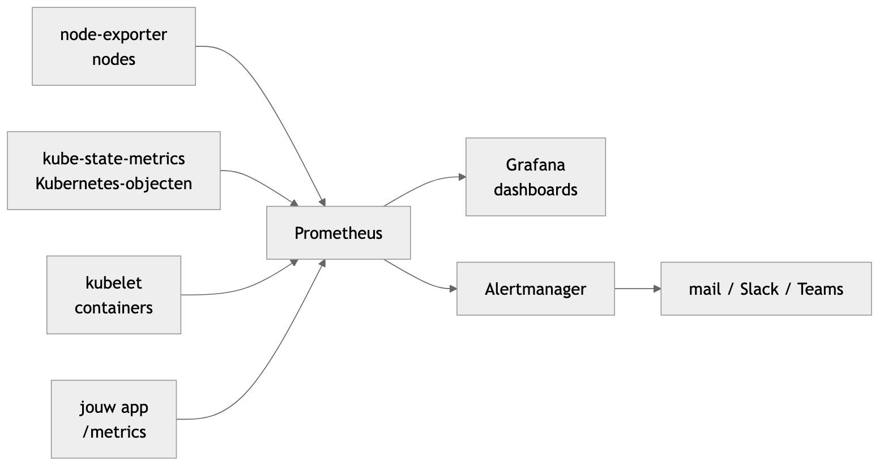

# 12 - Monitoring met Prometheus en Grafana

## Waar gaat deze les over?

### Het probleem: `kubectl` toont enkel *nu*

Je PetShelter draait in een cluster. Met `kubectl get pods` en `kubectl top` zie je hoe het er **op dit moment** voor
staat. Maar de vragen die je in productie echt stelt, kan je daarmee niet beantwoorden:

- Sinds wanneer is die pod zoveel geheugen gaan gebruiken? Was dat gisteren ook zo?
- Raakt de schijf van een node binnen een week vol?
- Hoeveel requests per seconde krijgt mijn backend, en hoeveel daarvan geven een fout?
- Ligt er iets plat **voordat** een gebruiker het komt melden?

Daarvoor moet je cijfers **voortdurend verzamelen**, ze **bewaren** (met geschiedenis), er **grafieken** van maken en
**gewaarschuwd** worden als iets fout loopt. Dat is monitoring.

### De oplossing: één Helm-commando

De chart **kube-prometheus-stack** installeert alles in één keer: **Prometheus** (verzamelt en bewaart de cijfers),
**Grafana** (dashboards), **Alertmanager** (verstuurt alerts) en de exporters die de cijfers van je nodes en
Kubernetes-objecten leveren. Er staan al tientallen dashboards en meer dan 100 alertregels klaar.

**Na deze les kan je:**
- uitleggen wat een metric is, en het verschil tussen een counter en een gauge;
- uitleggen hoe Prometheus metrics **ophaalt** (pull) en welke onderdelen de stack heeft;
- de stack installeren met Helm en Prometheus, Grafana en Alertmanager openen;
- eenvoudige PromQL-queries schrijven en lezen;
- je **eigen app** laten monitoren met een `ServiceMonitor`;
- een eigen alertregel schrijven met een `PrometheusRule`;
- uitleggen waarom je een cluster ook **van buitenaf** moet monitoren.

**Ook in dit hoofdstuk:**
- [Helm: Prometheus en Grafana](../07-Helm/helm-prometheus-grafana.md): de installatie stap voor stap, als demo van Helm
  als package manager;
- [Monitoring & Observability](monitoring-observability.md): verdieping (logs, traces, SLO's).

Voorbeeldbestanden: [kube-prometheus-stack/](kube-prometheus-stack/) en
[monitoring-values.yaml](../07-Helm/prometheus-grafana/monitoring-values.yaml). Voer de commando's uit in de map
`12-Monitoring` van de cursusrepository.

---

## 1. Het idee: metrics ophalen

### Metrics, logs en traces

| | Wat | Voorbeeld | Tool |
|---|---|---|---|
| **Metrics** | getallen die je over de tijd meet | 42 requests/s, 310 MB geheugen | **Prometheus** (deze les) |
| **Logs** | tekstregels over wat er gebeurde | `ERROR database timeout` | `kubectl logs`, Loki |
| **Traces** | de weg van één request langs al je services | frontend 200 ms → backend 150 ms → db 50 ms | Jaeger, Tempo |

Deze les gaat over **metrics**: ze zijn goedkoop om te bewaren, makkelijk om grafieken van te maken en ideaal voor
alerts. Logs en traces vind je in [Monitoring & Observability](monitoring-observability.md).

### Hoe ziet een metric eruit?

Een app die gemonitord wordt, toont een gewone webpagina `/metrics` met tekst:

```
# TYPE http_requests_total counter
http_requests_total{status="200"} 214
http_requests_total{status="404"} 3
# TYPE process_resident_memory_bytes gauge
process_resident_memory_bytes 2.4576e+07
```

Dit is een ingekort voorbeeld. Zelf bekijken doe je met `curl` op die pagina, bv. bij podinfo in sectie 6:
`curl localhost:9898/metrics`. In een browser zie je dezelfde tekst.

Elke regel is: een **naam**, **labels** tussen `{}` en een **waarde**. Elke combinatie van naam en labels is een aparte
**tijdreeks**: Prometheus bewaart elke 30 seconden een nieuwe waarde, zodat je een grafiek over de tijd krijgt.

| Type | Gedrag | Voorbeeld | Hoe je hem leest |
|---|---|---|---|
| **counter** | gaat enkel omhoog (terug naar 0 bij een herstart) | aantal requests, CPU-seconden | met `rate()`: hoe snel stijgt hij? |
| **gauge** | gaat op en neer | geheugen, aantal pods, temperatuur | rechtstreeks |

"Mijn backend heeft 1.204.311 requests gehad" zegt weinig. "Mijn backend krijgt nu 40 requests per seconde" wel: dat
is `rate()` op een counter.

### Pull: Prometheus haalt op

Je app **stuurt niets**. Prometheus heeft een lijst **targets** en vraagt elke 30 seconden bij elk ervan `/metrics`
op (*scrapen*). Is een target niet bereikbaar, dan weet Prometheus meteen dat hij down is: de metric `up` wordt `0`.

---

## 2. Installeren

```bash
minikube start --memory=4g --cpus=2

helm repo add prometheus-community https://prometheus-community.github.io/helm-charts
helm repo update

helm upgrade --install monitoring prometheus-community/kube-prometheus-stack \
  -n monitoring --create-namespace \
  -f ../07-Helm/prometheus-grafana/monitoring-values.yaml

kubectl get pods -n monitoring          # na 2 à 3 minuten alles Running
```

Het values-bestand geeft Grafana het wachtwoord `devops123`, bewaart metrics 7 dagen op een volume van 5Gi, en zet
de onderdelen van het control plane uit die je op Minikube toch niet kan bereiken.

> De stack is zwaar (een tiental pods). Draait Minikube al met minder geheugen, dan blijven pods `Pending`:
> `minikube delete` en opnieuw starten met `--memory=4g`.

---

## 3. Wat zit erin?

| Onderdeel | Wat het doet |
|---|---|
| **Prometheus** | haalt elke 30 seconden metrics op bij alle **targets** (`/metrics`) en bewaart ze |
| **node-exporter** | metrics van elke node: CPU, geheugen, schijf, netwerk (DaemonSet: één pod per node) |
| **kube-state-metrics** | metrics over Kubernetes-objecten: hoeveel replicas, welke pods niet Ready, … |
| **kubelet / cAdvisor** | CPU en geheugen per container (zit al in Kubernetes) |
| **Grafana** | dashboards bovenop Prometheus; een dertigtal dashboards is al ingesteld |
| **Alertmanager** | ontvangt alerts van Prometheus en verstuurt ze (mail, Slack, Teams, …) |
| **Prometheus Operator** | zet `ServiceMonitor`- en `PrometheusRule`-objecten om naar Prometheus-configuratie |



De pijlen tonen hoe de **data** stroomt. Het is wel Prometheus die de verbinding legt en `/metrics` ophaalt (pull).

---

## 4. Prometheus en PromQL

```bash
kubectl port-forward -n monitoring svc/monitoring-kube-prometheus-prometheus 9090:9090
```

Open http://localhost:9090.

- *Status → Targets*: alles wat Prometheus ophaalt, met `UP` of `DOWN`.
- *Query*: een **PromQL**-query uitvoeren, als tabel of als grafiek.

Enkele queries om te proberen:

| Query | Wat |
|---|---|
| `up` | 1 als een target bereikbaar is, 0 als hij down is |
| `sum by (namespace) (kube_pod_info)` | aantal pods per namespace |
| `kube_deployment_status_replicas_available` | beschikbare replicas per Deployment |
| `sum by (pod) (rate(container_cpu_usage_seconds_total{namespace="monitoring"}[5m]))` | CPU per pod (in cores) |
| `sum by (pod) (container_memory_working_set_bytes{namespace="monitoring", container!=""})` | geheugen per pod (bytes) |
| `100 * (1 - avg(rate(node_cpu_seconds_total{mode="idle"}[5m])))` | CPU-gebruik van de nodes, in % |
| `node_memory_MemAvailable_bytes` | vrij geheugen per node |
| `ALERTS{alertstate="firing"}` | alerts die nu afgaan |

Lezen van een query:

- `{namespace="monitoring"}`: enkel de tijdreeksen met dat **label**;
- `rate(…[5m])`: hoe snel een **counter** stijgt, per seconde, gemiddeld over de laatste 5 minuten. Namen die eindigen
  op `_total` of `_seconds_total` zijn counters: daar zet je `rate()` rond;
- `sum by (pod)`: optellen, met één resultaat per pod.

Lees een query **van binnen naar buiten**: eerst de metric met labels, dan `rate`, dan `sum by`.

---

## 5. Grafana

```bash
kubectl port-forward -n monitoring svc/monitoring-grafana 3000:80
```

Open http://localhost:3000 en log in met `admin` / `devops123`. Zonder values-bestand vraag je het wachtwoord op met:

```bash
kubectl get secret -n monitoring monitoring-grafana -o jsonpath="{.data.admin-password}" | base64 -d; echo
```

Onder *Dashboards* staan de kant-en-klare dashboards. De handigste:

| Dashboard | Wat je ziet |
|---|---|
| *Kubernetes / Compute Resources / Cluster* | CPU en geheugen van de hele cluster, per namespace |
| *Kubernetes / Compute Resources / Namespace (Pods)* | CPU en geheugen per pod, in een gekozen namespace |
| *Kubernetes / Compute Resources / Pod* | één pod in detail, per container |
| *Node Exporter / Nodes* | CPU, geheugen, schijf en netwerk per node |
| *Kubernetes / Persistent Volumes* | hoe vol je volumes zijn |

Grafana bewaart zelf **geen** metrics: elk paneel is een PromQL-query die Grafana aan Prometheus stelt. De **data
source** Prometheus is al ingesteld. Een eigen dashboard: *Dashboards → New → New dashboard → Add visualization*, kies
*Prometheus* en plak een query uit sectie 4.

### Grafana via Ingress

Met Traefik uit [les 8](../08-Ingress-and-Reverse-Proxies/ingress.md) heb je geen port-forward nodig. De chart
maakt de Ingress zelf: [kube-prometheus-stack/grafana-ingress.yaml](kube-prometheus-stack/grafana-ingress.yaml).

```yaml
grafana:
  ingress:
    enabled: true
    ingressClassName: traefik
    hosts:
      - grafana.localhost
```

```bash
helm upgrade monitoring prometheus-community/kube-prometheus-stack -n monitoring \
  --reuse-values -f kube-prometheus-stack/grafana-ingress.yaml
kubectl get ingress -n monitoring        # monitoring-grafana  traefik  grafana.localhost
```

Open http://grafana.localhost (met `minikube tunnel` actief).

`--reuse-values` behoudt de instellingen van de vorige install. Beter is om beide bestanden mee te geven:
`-f monitoring-values.yaml -f grafana-ingress.yaml`.

---

## 6. Je eigen app monitoren

Prometheus moet weten **welke** Services het moet ophalen. Dat zeg je met een **ServiceMonitor**, een object dat
de chart toevoegt (een CRD).

Voorbeeld met podinfo, dat metrics toont op `/metrics`:

```bash
helm repo add podinfo https://stefanprodan.github.io/podinfo
helm install podinfo podinfo/podinfo
```

Kijk eerst zelf wat Prometheus straks zal lezen:

```bash
kubectl port-forward svc/podinfo 9898:9898          # in een apart venster
curl -s localhost:9898/metrics | grep http_requests_total
```

Dan de ServiceMonitor ([kube-prometheus-stack/podinfo-servicemonitor.yaml](kube-prometheus-stack/podinfo-servicemonitor.yaml)):

```bash
kubectl apply -f kube-prometheus-stack/podinfo-servicemonitor.yaml
```

```yaml
apiVersion: monitoring.coreos.com/v1
kind: ServiceMonitor
metadata:
  name: podinfo
  namespace: default
  labels:
    release: monitoring          # verplicht, zie hieronder
spec:
  selector:
    matchLabels:
      app.kubernetes.io/name: podinfo   # welke Service
  endpoints:
    - port: http                 # naam van de poort in de Service
      path: /metrics
      interval: 15s
```

Na een minuut staat `podinfo` bij *Status → Targets*. Stuur wat verkeer en vraag het aantal requests per seconde op:

```bash
for i in $(seq 200); do curl -s localhost:9898/ > /dev/null; done
```

```
sum by (status) (rate(http_requests_total{job="podinfo"}[5m]))
```

### Hoe vindt Prometheus je ServiceMonitor?

```
ServiceMonitor   label release: monitoring
      │          ← Prometheus kijkt enkel naar ServiceMonitors met dit label
      ▼
Service          labels app.kubernetes.io/name: podinfo, poort met naam "http"
      │
      ▼
pods             Prometheus haalt /metrics op bij elke pod achter de Service
```

**Het label `release: monitoring` is verplicht.** Prometheus neemt enkel ServiceMonitors met het label van de
release:

```bash
kubectl get prometheus -n monitoring -o jsonpath='{.items[0].spec.serviceMonitorSelector}'
# {"matchLabels":{"release":"monitoring"}}
```

Vergeet je het label, dan verschijnt je target nooit, zonder foutmelding. Heet je release anders, dan wordt de
waarde van het label ook anders.

> Annotations zoals `prometheus.io/scrape: "true"` op je pods, uit oudere tutorials, doen niets met deze chart. Hier
> werk je altijd met een ServiceMonitor.

**Je eigen app** heeft een pagina `/metrics` nodig. Voor Node.js doet het pakket
[prom-client](https://github.com/siimon/prom-client) dat (voorbeeld in
[Monitoring & Observability](monitoring-observability.md)). Daarna is het dezelfde ServiceMonitor, met de labels en de
poortnaam van jouw Service. Geef de poort in je Service daarvoor een **naam** (`name: http`).

---

## 7. Alerts

De chart brengt meer dan 100 alertregels mee (`PrometheusRule`-objecten): een node met een volle schijf, een pod die
blijft herstarten, een target die down is, …

```bash
kubectl get prometheusrules -n monitoring
kubectl port-forward -n monitoring svc/monitoring-kube-prometheus-alertmanager 9093:9093
```

- In Prometheus, onder *Alerts*: welke regels er zijn en of ze `pending` of `firing` zijn.
- In Alertmanager (http://localhost:9093): welke alerts verstuurd worden.

Er gaat **altijd** één alert af: `Watchdog`. Dat is met opzet. Komt die alert niet meer binnen, dan weet je dat je
monitoring zelf kapot is.

Een eigen regel, bv. als podinfo geen replicas meer heeft
([kube-prometheus-stack/podinfo-alert.yaml](kube-prometheus-stack/podinfo-alert.yaml)):

```yaml
apiVersion: monitoring.coreos.com/v1
kind: PrometheusRule
metadata:
  name: podinfo-alerts
  namespace: default
  labels:
    release: monitoring          # ook hier verplicht
spec:
  groups:
    - name: podinfo
      rules:
        - alert: PodinfoDown
          expr: kube_deployment_status_replicas_available{deployment="podinfo"} == 0
          for: 1m
          labels:
            severity: critical
          annotations:
            summary: podinfo heeft geen werkende pods
```

| Veld | Betekenis |
|---|---|
| `expr` | een PromQL-query: geeft hij een resultaat, dan is de alert actief |
| `for: 1m` | eerst 1 minuut `pending`, pas daarna `firing`: geen alarm bij een korte hapering |
| `labels.severity` | hoe ernstig; Alertmanager kan daarop beslissen naar wie hij de alert stuurt |
| `annotations.summary` | de tekst in de melding |

```bash
kubectl apply -f kube-prometheus-stack/podinfo-alert.yaml
kubectl scale deploy podinfo --replicas=0        # kijk na een minuut bij Alerts: pending → firing
kubectl scale deploy podinfo --replicas=1        # en de alert verdwijnt weer
```

---

## 8. Van buiten de cluster monitoren

Alles wat je tot nu toe installeerde, draait **in** de cluster die het bewaakt. Valt de cluster weg (nodes down,
netwerk stuk), dan valt je monitoring mee weg, en dan krijg je net **geen** alert. Een brandalarm dat mee afbrandt.

Daarom monitor je een productiecluster ook **van buitenaf**. In de
[Final CloudInfra](../00-Assessment/CloudInfrastructure/2-Final-Assessment-CloudInfra.md) is dat een vereiste: de
monitoring draait niet (enkel) in de cluster zelf.

| Aanpak | Wat het ziet | Moeite |
|---|---|---|
| **Externe uptimedienst** (bv. UptimeRobot, Better Stack) | is mijn website bereikbaar vanaf het internet? | klein |
| **Monitoring-VM met Prometheus + Grafana** | nodes (CPU, geheugen, schijf) en je website, ook als de cluster plat ligt | middel |
| **Zabbix** of **Flowmon** op een eigen VM | idem, met een ander tool | middel |

### Schets: Prometheus op een aparte VM

Op de monitoring-VM draai je Prometheus en Grafana (bv. met Docker Compose, zoals in les 1), plus de
**blackbox-exporter**: die bezoekt je website zoals een gebruiker en meet of hij antwoordt. Prometheus haalt op:

- de **node-exporter** op elke node (poort 9100). Die draait al door kube-prometheus-stack; controleer vanaf de VM
  met `curl http://<node-ip>:9100/metrics`. Gebruik het **private** IP of je VPN: poort 9100 zet je niet open naar
  het internet;
- je **website** via de blackbox-exporter.

```yaml
# prometheus.yml op de monitoring-VM (schets)
scrape_configs:
  - job_name: nodes
    static_configs:
      - targets: ['10.0.0.11:9100', '10.0.0.12:9100', '10.0.0.13:9100']   # private IP's van je nodes

  - job_name: website
    metrics_path: /probe
    params:
      module: [http_2xx]                      # verwacht een 2xx-antwoord
    static_configs:
      - targets: ['https://petshelter.jouwdomein.be']
    relabel_configs:                          # stuur de vraag via de blackbox-exporter
      - source_labels: [__address__]
        target_label: __param_target
      - source_labels: [__param_target]
        target_label: instance
      - target_label: __address__
        replacement: blackbox:9115
```

Alerts op deze VM: `up{job="nodes"} == 0` (node onbereikbaar) en `probe_success == 0` (website down). Dit zijn
precies de dingen die de monitoring **in** de cluster niet kan melden als de cluster zelf weg is.

> Combineer beide: kube-prometheus-stack in de cluster voor het detail (pods, containers, je app), en monitoring
> van buitenaf voor "leeft de cluster nog?".

---

## 9. Fouten zoeken

| Wat je ziet | Oorzaak |
|---|---|
| pods blijven `Pending` | te weinig geheugen: `minikube start --memory=4g`, of een PVC zonder StorageClass |
| targets `kube-scheduler`, `kube-etcd`, … `DOWN` | normaal op Minikube; zet ze uit in je values (zie [monitoring-values.yaml](../07-Helm/prometheus-grafana/monitoring-values.yaml)) |
| je ServiceMonitor verschijnt niet bij *Targets* | label `release: monitoring` ontbreekt, of de `selector` of de poort**naam** klopt niet |
| target staat er, maar `DOWN` | verkeerd `path`, of de app toont geen `/metrics` |
| query geeft `Empty query result` | tikfout in de metric of een label, of het target is (nog) niet `UP` |
| je PrometheusRule verschijnt niet bij *Alerts* | label `release: monitoring` ontbreekt |
| Grafana: wachtwoord klopt niet | lees het uit de Secret (sectie 5); `prom-operator` uit oude tutorials werkt niet meer |
| na `helm uninstall` blijven er dingen staan | PVC's en CRDs worden met opzet niet verwijderd |

---

## 10. Commando's

| Commando | Wat |
|---|---|
| `kubectl get pods -n monitoring` | draait de stack? |
| `kubectl port-forward -n monitoring svc/monitoring-kube-prometheus-prometheus 9090:9090` | Prometheus |
| `kubectl port-forward -n monitoring svc/monitoring-grafana 3000:80` | Grafana |
| `kubectl port-forward -n monitoring svc/monitoring-kube-prometheus-alertmanager 9093:9093` | Alertmanager |
| `kubectl get servicemonitors -A` | welke apps Prometheus ophaalt |
| `kubectl get prometheusrules -A` | alle alertregels |
| `helm uninstall monitoring -n monitoring` | de stack verwijderen |

---

## Oefeningen

1. Installeer de stack. Hoeveel pods draaien er in elke namespace? Gebruik een PromQL-query, niet `kubectl`.
2. Open het dashboard *Kubernetes / Compute Resources / Namespace (Pods)* voor `monitoring`. Welke pod gebruikt het
   meeste geheugen?
3. Voer `container_cpu_usage_seconds_total{namespace="monitoring"}` uit, eerst zonder en dan met `rate(…[5m])`. Wat
   is het verschil, en waarom is de versie zonder `rate` nutteloos in een grafiek?
4. Maak in Grafana een eigen dashboard met één grafiek: het aantal beschikbare replicas van elke Deployment.
5. Monitor podinfo met een ServiceMonitor. Verwijder daarna het label `release` en kijk wat er gebeurt (na 1 à 2
   minuten).
6. Voeg de alert `PodinfoDown` toe en laat hem afgaan. Hoe lang staat hij op `pending` voor hij `firing` wordt?
7. **PetShelter.** Maak Grafana van je eigen cluster bereikbaar via de Ingress, op een eigen hostnaam.
8. **Van buitenaf.** Zet een gratis externe uptimecheck op je PetShelter-domein. Schaal de frontend naar 0 replicas:
   na hoeveel tijd krijg je een melding? Welke monitoring zou je missen als je hele cluster down is?
