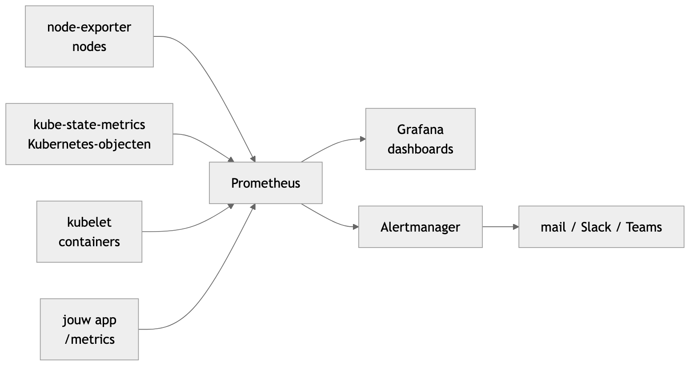

# 12 - Monitoring met Prometheus en Grafana (kube-prometheus-stack)

Een volledige monitoringstack op je cluster, geïnstalleerd met één Helm-commando, en hoe je die gebruikt:

- Prometheus en PromQL;
- de dashboards in Grafana;
- alerts;
- je **eigen app** laten monitoren.

De installatie zelf, stap voor stap en als demo van Helm als package manager, staat in
[Helm: Prometheus en Grafana](../07-Helm/helm-prometheus-grafana.md). De theorie (metrics, logs, traces, SLO's) staat
in [Monitoring & Observability](monitoring-observability.md).

Voorbeeldbestanden: [kube-prometheus-stack/](kube-prometheus-stack/) en
[monitoring-values.yaml](../07-Helm/prometheus-grafana/monitoring-values.yaml).

---

## 1. Installeren

```bash
minikube start --memory=4g --cpus=2

helm repo add prometheus-community https://prometheus-community.github.io/helm-charts
helm repo update

helm upgrade --install monitoring prometheus-community/kube-prometheus-stack \
  -n monitoring --create-namespace \
  -f ../07-Helm/prometheus-grafana/monitoring-values.yaml

kubectl get pods -n monitoring          # na 2 à 3 minuten alles Running
```

Het values-bestand geeft Grafana het wachtwoord `devops123`, bewaart metrics 7 dagen op een volume van 5Gi, en zet
de onderdelen van het control plane uit die je op Minikube toch niet kan bereiken.

---

## 2. Wat zit erin?

| Onderdeel | Wat het doet |
|---|---|
| **Prometheus** | haalt elke 30 seconden metrics op bij alle **targets** (`/metrics`) en bewaart ze |
| **node-exporter** | metrics van elke node: CPU, geheugen, schijf, netwerk (DaemonSet: één pod per node) |
| **kube-state-metrics** | metrics over Kubernetes-objecten: hoeveel replicas, welke pods niet Ready, … |
| **kubelet / cAdvisor** | CPU en geheugen per container (zit al in Kubernetes) |
| **Grafana** | dashboards bovenop Prometheus; 29 dashboards zijn al ingesteld |
| **Alertmanager** | ontvangt alerts van Prometheus en verstuurt ze (mail, Slack, Teams, …) |
| **Prometheus Operator** | zet `ServiceMonitor`- en `PrometheusRule`-objecten om naar Prometheus-configuratie |



Prometheus **haalt** de metrics op (*pull*): je app stuurt niets, hij toont enkel een pagina `/metrics`.

---

## 3. Prometheus en PromQL

```bash
kubectl port-forward -n monitoring svc/monitoring-kube-prometheus-prometheus 9090:9090
```

Open http://localhost:9090.

- *Status → Targets*: alles wat Prometheus ophaalt, met `UP` of `DOWN`.
- *Query*: een **PromQL**-query uitvoeren, als tabel of als grafiek.

Enkele queries om te proberen:

| Query | Wat |
|---|---|
| `up` | 1 als een target bereikbaar is, 0 als hij down is |
| `sum by (namespace) (kube_pod_info)` | aantal pods per namespace |
| `kube_deployment_status_replicas_available` | beschikbare replicas per Deployment |
| `sum by (pod) (rate(container_cpu_usage_seconds_total{namespace="monitoring"}[5m]))` | CPU per pod (in cores) |
| `sum by (pod) (container_memory_working_set_bytes{namespace="monitoring", container!=""})` | geheugen per pod (bytes) |
| `100 * (1 - avg(rate(node_cpu_seconds_total{mode="idle"}[5m])))` | CPU-gebruik van de nodes, in % |
| `node_memory_MemAvailable_bytes` | vrij geheugen per node |
| `ALERTS{alertstate="firing"}` | alerts die nu afgaan |

Lezen van een query:

- `{namespace="monitoring"}`: enkel de metrics met dat **label**;
- `rate(…[5m])`: hoe snel een teller stijgt, per seconde, over de laatste 5 minuten;
- `sum by (pod)`: optellen per pod.

---

## 4. Grafana

```bash
kubectl port-forward -n monitoring svc/monitoring-grafana 3000:80
```

Open http://localhost:3000 en log in met `admin` / `devops123`. Zonder values-bestand vraag je het wachtwoord op met:

```bash
kubectl get secret -n monitoring monitoring-grafana -o jsonpath="{.data.admin-password}" | base64 -d; echo
```

Onder *Dashboards* staan de kant-en-klare dashboards. De handigste:

| Dashboard | Wat je ziet |
|---|---|
| *Kubernetes / Compute Resources / Cluster* | CPU en geheugen van de hele cluster, per namespace |
| *Kubernetes / Compute Resources / Namespace (Pods)* | CPU en geheugen per pod, in een gekozen namespace |
| *Kubernetes / Compute Resources / Pod* | één pod in detail, per container |
| *Node Exporter / Nodes* | CPU, geheugen, schijf en netwerk per node |
| *Kubernetes / Persistent Volumes* | hoe vol je volumes zijn |

De **data source** Prometheus is al ingesteld. Een eigen dashboard: *Dashboards → New → New dashboard → Add
visualization*, kies *Prometheus* en plak een query uit sectie 3.

### Grafana via Ingress

Met Traefik uit [les 8](../08-Ingress-and-Reverse-Proxies/ingress.md) heb je geen port-forward nodig. De chart
maakt de Ingress zelf: [kube-prometheus-stack/grafana-ingress.yaml](kube-prometheus-stack/grafana-ingress.yaml).

```yaml
grafana:
  ingress:
    enabled: true
    ingressClassName: traefik
    hosts:
      - grafana.localhost
```

```bash
helm upgrade monitoring prometheus-community/kube-prometheus-stack -n monitoring \
  --reuse-values -f kube-prometheus-stack/grafana-ingress.yaml
kubectl get ingress -n monitoring        # monitoring-grafana  traefik  grafana.localhost
```

Open http://grafana.localhost (met `minikube tunnel` actief).

`--reuse-values` behoudt de instellingen van de vorige install. Beter is om beide bestanden mee te geven:
`-f monitoring-values.yaml -f grafana-ingress.yaml`.

---

## 5. Je eigen app monitoren

Prometheus moet weten **welke** Services het moet ophalen. Dat zeg je met een **ServiceMonitor**, een object dat
de chart toevoegt (een CRD).

Voorbeeld met podinfo, dat metrics toont op `/metrics`:

```bash
helm repo add podinfo https://stefanprodan.github.io/podinfo
helm install podinfo podinfo/podinfo
kubectl apply -f kube-prometheus-stack/podinfo-servicemonitor.yaml
```

```yaml
apiVersion: monitoring.coreos.com/v1
kind: ServiceMonitor
metadata:
  name: podinfo
  namespace: default
  labels:
    release: monitoring          # verplicht, zie hieronder
spec:
  selector:
    matchLabels:
      app.kubernetes.io/name: podinfo   # welke Service
  endpoints:
    - port: http                 # naam van de poort in de Service
      path: /metrics
      interval: 15s
```

Na een minuut staat `podinfo` bij *Status → Targets*. Stuur wat verkeer en vraag het aantal requests per seconde op:

```bash
kubectl port-forward svc/podinfo 9898:9898
for i in $(seq 200); do curl -s localhost:9898/ > /dev/null; done
```

```
sum by (status) (rate(http_requests_total{job="podinfo"}[5m]))
```

**Het label `release: monitoring` is verplicht.** Prometheus neemt enkel ServiceMonitors met het label van de
release:

```bash
kubectl get prometheus -n monitoring -o jsonpath='{.items[0].spec.serviceMonitorSelector}'
# {"matchLabels":{"release":"monitoring"}}
```

Vergeet je het label, dan verschijnt je target nooit, zonder foutmelding. Heet je release anders, dan wordt de
waarde van het label ook anders.

**Je eigen app** heeft een pagina `/metrics` nodig. Voor Node.js doet het pakket
[prom-client](https://github.com/siimon/prom-client) dat. Daarna is het dezelfde ServiceMonitor, met de labels en de
poortnaam van jouw Service. Geef de poort in je Service daarvoor een **naam** (`name: http`).

---

## 6. Alerts

De chart brengt meer dan 100 alertregels mee (`PrometheusRule`-objecten): een node met een volle schijf, een pod die
blijft herstarten, een target die down is, …

```bash
kubectl get prometheusrules -n monitoring
kubectl port-forward -n monitoring svc/monitoring-kube-prometheus-alertmanager 9093:9093
```

- In Prometheus, onder *Alerts*: welke regels er zijn en of ze `pending` of `firing` zijn.
- In Alertmanager (http://localhost:9093): welke alerts verstuurd worden.

Er gaat **altijd** één alert af: `Watchdog`. Dat is met opzet. Komt die alert niet meer binnen, dan weet je dat je
monitoring zelf kapot is.

Een eigen regel, bv. als podinfo geen replicas meer heeft:

```yaml
apiVersion: monitoring.coreos.com/v1
kind: PrometheusRule
metadata:
  name: podinfo-alerts
  namespace: default
  labels:
    release: monitoring          # ook hier verplicht
spec:
  groups:
    - name: podinfo
      rules:
        - alert: PodinfoDown
          expr: kube_deployment_status_replicas_available{deployment="podinfo"} == 0
          for: 1m
          labels:
            severity: critical
          annotations:
            summary: podinfo heeft geen werkende pods
```

Test: `kubectl scale deploy podinfo --replicas=0` en kijk na een minuut bij *Alerts*.

---

## 7. Fouten zoeken

| Wat je ziet | Oorzaak |
|---|---|
| pods blijven `Pending` | te weinig geheugen: `minikube start --memory=4g`, of een PVC zonder StorageClass |
| targets `kube-scheduler`, `kube-etcd`, … `DOWN` | normaal op Minikube; zet ze uit in je values (zie [monitoring-values.yaml](../07-Helm/prometheus-grafana/monitoring-values.yaml)) |
| je ServiceMonitor verschijnt niet bij *Targets* | label `release: monitoring` ontbreekt, of de `selector` of de poort**naam** klopt niet |
| target staat er, maar `DOWN` | verkeerd `path`, of de app toont geen `/metrics` |
| Grafana: wachtwoord klopt niet | lees het uit de Secret (sectie 4); `prom-operator` uit oude tutorials werkt niet meer |
| na `helm uninstall` blijven er dingen staan | PVC's en CRDs worden met opzet niet verwijderd |

---

## Oefeningen

1. Installeer de stack. Hoeveel pods draaien er in elke namespace? Gebruik een PromQL-query, niet `kubectl`.
2. Open het dashboard *Kubernetes / Compute Resources / Namespace (Pods)* voor `monitoring`. Welke pod gebruikt het
   meeste geheugen?
3. Maak in Grafana een eigen dashboard met één grafiek: het aantal beschikbare replicas van elke Deployment.
4. Monitor podinfo met een ServiceMonitor. Verwijder daarna het label `release` en kijk wat er gebeurt (na 1 à 2
   minuten).
5. Voeg de alert `PodinfoDown` toe en laat hem afgaan.
6. **PetShelter.** Maak Grafana van je eigen cluster bereikbaar via de Ingress, op een eigen hostnaam.
